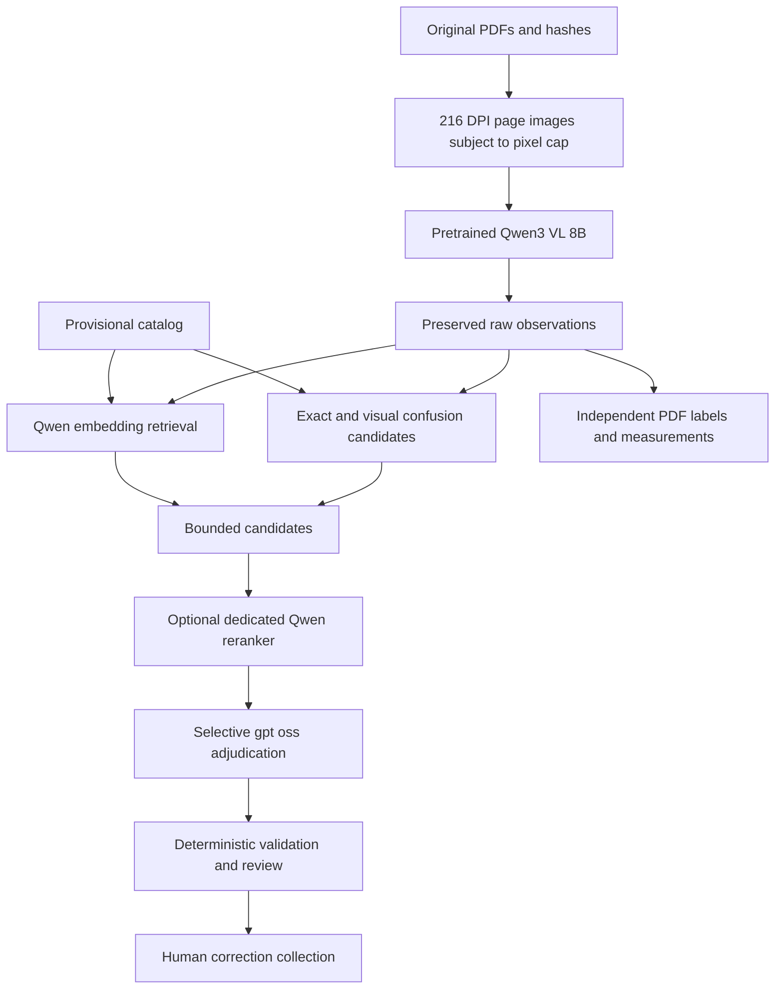

# Self-hosted inference and evaluation infrastructure

**Historical comparison status:** this guide records the removed pretrained Qwen prototype and prior deployment research. Its commands no longer apply. The current product goal is in [PROJECT_GOAL.md](../../PROJECT_GOAL.md); local-model inference and training are outside the adopted implementation plan. The original framework DOCX remains under `docs/research/` as source evidence. See [first results](framework-first-results.md) and [research adoption decisions](../research/document-ai-research-adoption-2026-10-02.md).

## Model roles

| Role | Model/service | Execution contract |
| --- | --- | --- |
| Visual extraction | `qwen3-vl:8b-instruct` | Local Ollama; page image plus separate native text observations; strict JSON |
| Comparison baseline | `qwen3-vl:4b-instruct` | Same schema and labeled PDFs for development comparison |
| Semantic candidate retrieval | `qwen3-embedding:0.6b` | Genuine `/api/embed` vectors and cosine ranking; cached catalog vectors |
| Candidate reranking | `Qwen/Qwen3-Reranker-0.6B` | Dedicated CPU CrossEncoder service on port 11436; actual logit scores |
| Ambiguous adjudication | `gpt-oss:20b` | Text-only local call, low reasoning, candidate-constrained structured recommendation |
| Independent visual verification | `PaddlePaddle/PaddleOCR-VL-1.6` | Pending full layout/VLM pipeline installation and real PDF comparison |

These are configured targets. `model_stack.py` records current service/model readiness without loading weights, and each inference run records actual provider usage and model digests. A downloaded model is not marked end-to-end verified by the readiness checker. See [verified primary deployment sources](model-stack-sources.md).



Exact candidates and raw observations survive every stage. Weighted character-confusion matches and vector/reranker scores are suggestions, not authoritative identifier mappings or calibrated probabilities. Exact rows skip the adjudicator only when source evidence, all identifiers, full description and quantity/unit checks establish an unambiguous case. Other cases retain uncertainty. Unknown IDs and conflicts cannot be repaired into automatic matches by a plausible description.

## Local machine and isolation

The current machine has a Ryzen 7 5800X, approximately 32 GB RAM, and an RX 6700 XT with approximately 12 GB VRAM. Its portable Ollama v0.35.0 uses the working Vulkan backend on loopback port 11435. Preserve that runtime. The 20B model's approximately 14 GB weight download exceeds GPU VRAM; sequential loading/offload and measured latency are required. The server already allows one loaded model and one parallel request. Model switches can dominate small-corpus timing.

Project models, source PDFs, reports, runtime files and human corrections live in ignored `data/` and `output/`. Existing OneDrive synchronization applies to this directory. The framework DOCX is the retained versioned research document, not test data. The pre-framework working source was preserved in `output/checkpoint-before-framework-*` before edits.

PDF rendering requests 216 DPI and retains an eight-million-pixel cap, so large pages can have lower effective DPI. Each vision result records this limit. Native text corroboration remains useful but cannot independently validate a scan. Paddle verification is pending; repeated Qwen calls must not be presented as independent model agreement.

## Setup and usage

Use the existing project virtual environment:

```powershell
powershell -ExecutionPolicy Bypass -File .\setup-model-stack.ps1
& .\.venv\Scripts\python.exe model_stack.py
& .\.venv\Scripts\python.exe reader.py analyze 'PATH_TO_AUTHORIZED_TEST_PDF.pdf' --summary
```

The cascade configuration is `config/model-stack.json`. CLI `--model`, `--adjudicator-model`, `--base-url`, `--timeout`, `--no-semantic` and `--no-reranker` override the corresponding run choices. `--pipeline single --model qwen3-vl:4b-instruct` runs the earlier comparison baseline. OpenAI remains an optional, explicitly selected provider with an API key; the framework workflow defaults to local inference.

The dedicated reranker uses an isolated CPU environment; it does not install PyTorch into the existing PDF-reader environment:

```powershell
powershell -ExecutionPolicy Bypass -File .\setup-reranker.ps1
powershell -ExecutionPolicy Bypass -File .\run-reranker.ps1
```

The launcher starts/reuses a hidden service, redirects logs and retains its process ID. `/health` distinguishes a reachable server from a loaded model. Missing reranking records an unavailable stage and retains existing candidates. It never asks a generative model to invent relevance scores. Paddle's full pipeline is a later supported-runtime task; its reported parser benchmarks do not describe the current prototype.

## Compare visual reading with the supplied PDFs

The live ZIP inventory has 33 PDFs and 45 pages. An unchanged private copy is retained as `data/corpora/full-data-set.zip`, with a corpus manifest/hash beside it. The seven earlier original PDFs remain in `data/originals/`. The independent development labels currently cover two ZIP PDFs, three source pages and 14 product rows. Keep duplicate pages and related documents together in future splits. These counts describe the current corpus and are not the framework's proposed 100–200 or several-hundred-document target.

```powershell
& .\.venv\Scripts\python.exe benchmark_vision.py --mode native --label-file output/vision-gold-representative.json --output-dir output/native-run
& .\.venv\Scripts\python.exe benchmark_vision.py --mode vision --model qwen3-vl:8b-instruct --pipeline cascade --extraction-only --only-labeled --label-file output/vision-gold-representative.json --timeout 600 --output-dir output/8b-run
```

`--extraction-only` supplies an empty candidate catalog to isolate visual reading from reconciliation. Labels are keyed by original PDF SHA-256. Missing and failed pages remain in scoring denominators. Unverified templates never create accuracy credit. To collect predictions on more PDFs, omit `--only-labeled` and use `--limit` for a bounded first batch; the unlabeled cases remain unscored.

`run-framework-evaluation.ps1` repeats the paired 4B/8B extraction-only evaluation sequentially and collects pending review records into a fresh timestamped output directory. It accepts `-SourceZip` and `-LabelFile`; it uses the currently versioned extraction prompt without training.

Benchmark output includes raw page records, extracted lines, page failures, model identities, stage usage, corpus hashes, duplicate grouping and independent-label scores. The actual website product match cannot be scored until an authoritative catalog and approved catalog labels exist.

`exact_raw_line_recall`/precision measure identifier sets, quantity and unit without identifier roles. `exact_role_line_recall`/precision also require exact source roles. Complete-document correctness requires roles and the PO number. The older `exact_line_recall`/precision names remain aliases of the raw metrics. Candidate recall and catalog accuracy require independent authoritative catalog labels and cannot be inferred from source identifier labels.

## Collect and approve review data

```powershell
& .\.venv\Scripts\python.exe collect_review.py collect --result output/8b-run/vision-benchmark-vision.json --run-id 8b-run
& .\.venv\Scripts\python.exe collect_review.py --help
& .\.venv\Scripts\python.exe collect_review.py approve --help
& .\.venv\Scripts\python.exe collect_review.py export --help
```

Collection creates pending private records with raw predictions separate from null human corrections. Supply the original source PDFs/ZIP, review every source page, and enter corrections with a named human reviewer before approval. Hash mismatch or incomplete review is rejected. Recollection preserves existing corrections. Export includes approved records only, in the existing benchmark label schema. The precise approval/export arguments are documented by each command's help; no training command exists.

## Current evidence

The first framework-aligned runs are retained under `output/framework-poc-20261001/`, with separate native, 4B and 8B directories where completed. Use each report's summary and actual usage for measured behavior; do not infer success from a requested model name or readiness state. The run findings are recorded in `framework-first-results.md` after verification.

The catalog remains provisional, the remaining documents need independent labels, and Paddle verification awaits its runtime. The framework's suggested recall/precision thresholds are future acceptance targets; no production-quality claim follows from two development PDFs.
