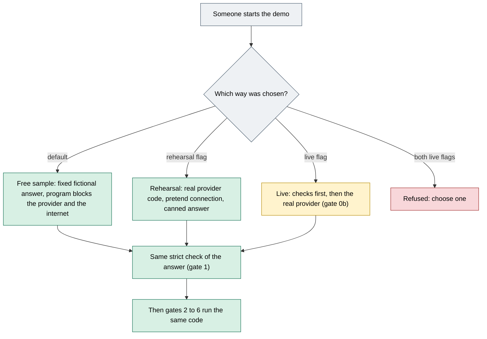

# Gate 0a: Free, rehearsal or live

[Back to the map](README.md) | Next: [Gate 0b, checks before anything is sent](00b-checks-before-sending.md)

## In one minute
The same app can be started in three different ways. **Of the three, only the live way sends a document to an AI provider.** (Separate command-line helper scripts for one-off probes exist too; they are not part of the demo page.) The other two show the screens and the review steps without any real reading, so what they show says nothing about how well the AI reads real orders.

| | **Free sample** (the default) | **Rehearsal** | **Live** |
| --- | --- | --- | --- |
| Who writes the answer | A fixed, hand-written fictional answer, looked up by the exact bytes of the file | One canned answer from a pretend connection, the same whatever file is sent | The AI model, over the real internet |
| Reads my own file? | No. A file whose bytes are not one of the registered samples is refused: "This free preview can only read the sample orders." | No. The canned answer does not depend on the file's content | Yes, through the demo page, after the person confirms that exact file |
| Real internet allowed? | The program blocks the HTTP client the provider code uses | The same block (the pretend connection is used instead) | Yes. The program does not block it ([`poc-demo.py` lines 171-172](https://github.com/CarlitosRed/advance-po-reader/blob/a76aa4a866e2929cb3cead1109b1b9391b3e9279/scripts/poc-demo.py#L171-L172)) |
| Key needed? | No | No (a made-up one is used inside the program) | Yes, in the server's ignored settings file |
| Costs money? | No | No | It can |
| What it is good for | Trying the screens with invented orders | Trying the live screens (confirm box, cost counter, waiting, errors) with no key and no network | A real reading of one authorized file |

## How the three ways meet

Green is no money and no real reading. Amber is the only way that can spend money and send a document. Red is a stop. Gray is structure.

## Worked example (invented)
Order `PO-TEST-020` is a made-up one-page PDF, saved on a computer.
- **Free sample:** dropping it on the upload page (with no Send step in this way), once it passes the upload checks, shows "This free preview can only read the sample orders", because its bytes are not one of the registered samples. The same page offers the sample orders instead.
- **Rehearsal:** the first time it is dropped, when it is a PDF or picture and neither the run limit nor the cost limit has been reached, it shows the Send box and the cost counter; after Send, if it passes the file checks of [gate 0b](00b-checks-before-sending.md), lines appear. They are the canned sample lines, not lines from `PO-TEST-020`.
- **Live:** the first time it is dropped, when it is a PDF or picture and neither the run limit nor the cost limit has been reached, it shows the Send box. Only after "Send", and only if the other checks of [gate 0b](00b-checks-before-sending.md) pass, is the file read by the real model, and the lines are whatever it wrote down.

## What each way really does
**Free sample.**
- Answers come from a registry keyed by the file's SHA-256 fingerprint and media type. Unknown bytes get the error `poc_unknown_fixture_bytes` ([`FixedProvider`, lines 336-358](https://github.com/CarlitosRed/advance-po-reader/blob/a76aa4a866e2929cb3cead1109b1b9391b3e9279/scripts/poc_demo_support.py#L336-L358)). The registry holds the generated sample files, plus any extra fictional surrogates stored in the demo's own data folder ([`poc-demo.py` lines 36-43](https://github.com/CarlitosRed/advance-po-reader/blob/a76aa4a866e2929cb3cead1109b1b9391b3e9279/scripts/poc-demo.py#L36-L43)).
- The program replaces the provider functions and the internet transport with ones that stop with an error, and, through Python's usual file-opening calls, refuses to open any file whose name starts with `.env` ([`offline_boundary`, lines 26-60](https://github.com/CarlitosRed/advance-po-reader/blob/a76aa4a866e2929cb3cead1109b1b9391b3e9279/scripts/poc_demo_support.py#L26-L60)).
- The server also answers `poc_offline_only_use_demo_entry` to any request to create a run whose provider is not the fictional one (`synthetic`) ([`poc-demo.py` lines 49-57](https://github.com/CarlitosRed/advance-po-reader/blob/a76aa4a866e2929cb3cead1109b1b9391b3e9279/scripts/poc-demo.py#L49-L57)).
- The catalog is the 153 invented products (150 plus three added for the sample order that shows reason sentences), unless a private catalog file outside the repository is named; only then is the fixed size rule relaxed ([`CATALOG_SIZE` and `load_catalog`, lines 164-211](https://github.com/CarlitosRed/advance-po-reader/blob/a76aa4a866e2929cb3cead1109b1b9391b3e9279/scripts/poc_demo_support.py#L164-L211)).

**Rehearsal.**
- It uses the real provider code, but its connection is a pretend one that always answers with the same canned one-page sample, built from the first fictional case ([`rehearsal_transport`, lines 165-171](https://github.com/CarlitosRed/advance-po-reader/blob/742666345a97dd00c1ed0d9e1ab725618bed3110/scripts/poc_live_support.py#L165-L171); [`poc-demo.py` lines 109-114](https://github.com/CarlitosRed/advance-po-reader/blob/a76aa4a866e2929cb3cead1109b1b9391b3e9279/scripts/poc-demo.py#L109-L114)). The real internet is still blocked ([`poc-demo.py` line 173](https://github.com/CarlitosRed/advance-po-reader/blob/a76aa4a866e2929cb3cead1109b1b9391b3e9279/scripts/poc-demo.py#L173)).
- The settings use a throwaway token and a made-up key, so no real key is needed ([`live_settings`, lines 49-58](https://github.com/CarlitosRed/advance-po-reader/blob/742666345a97dd00c1ed0d9e1ab725618bed3110/scripts/poc_live_support.py#L49-L58)).
- The cost counter and the Send box are installed as in live mode. A rehearsal reading is stored as an ordinary (not "synthetic") attempt, so the run counter counts it ([`service.py` lines 127-134](https://github.com/CarlitosRed/advance-po-reader/blob/742666345a97dd00c1ed0d9e1ab725618bed3110/backend/service.py#L127-L134)).

**Live.**
- The program refuses to start unless there is a private local token (not the shared default) and a key in the server's ignored settings file; it never prints either ([`check_live_settings`, lines 24-46](https://github.com/CarlitosRed/advance-po-reader/blob/742666345a97dd00c1ed0d9e1ab725618bed3110/scripts/poc_live_support.py#L24-L46); [`poc-demo.py` lines 164-170](https://github.com/CarlitosRed/advance-po-reader/blob/a76aa4a866e2929cb3cead1109b1b9391b3e9279/scripts/poc-demo.py#L164-L170)).
- The offline guards are not installed, because the server talks to the provider with its own settings ([`poc-demo.py` lines 171-172](https://github.com/CarlitosRed/advance-po-reader/blob/a76aa4a866e2929cb3cead1109b1b9391b3e9279/scripts/poc-demo.py#L171-L172)).
- Asking for both live flags is refused ([`poc-demo.py` lines 162-163](https://github.com/CarlitosRed/advance-po-reader/blob/a76aa4a866e2929cb3cead1109b1b9391b3e9279/scripts/poc-demo.py#L162-L163)).
- Optional **image mode**: with the setting `PO_POC_PDF_AS_IMAGES` on, a one-page PDF is sent as a picture of the page; a PDF with more pages stops with a plain message ([`PdfAsImageProvider`, lines 182-207](https://github.com/CarlitosRed/advance-po-reader/blob/742666345a97dd00c1ed0d9e1ab725618bed3110/scripts/poc_live_support.py#L182-L207)).

## What this does and does not prove
- The free and rehearsal ways show how the screens, the saving of answers and the error messages behave. They measure nothing about how well the AI reads real orders; the reading figures in the [map](README.md) come from live reads of the 33 sample orders.
- The free way answers only for files it was given an answer for. It is not evidence that the app can read an arbitrary file.
- I did not run any of the three ways for this page; it comes from reading the code at the fixed commit.

## Where it lives
- [`scripts/poc-demo.py`](https://github.com/CarlitosRed/advance-po-reader/blob/a76aa4a866e2929cb3cead1109b1b9391b3e9279/scripts/poc-demo.py): the mode choice and the free, rehearsal and live setups.
- [`scripts/poc_demo_support.py`](https://github.com/CarlitosRed/advance-po-reader/blob/a76aa4a866e2929cb3cead1109b1b9391b3e9279/scripts/poc_demo_support.py): the offline guards, the fixed provider, the catalog loader.
- [`scripts/poc_live_support.py`](https://github.com/CarlitosRed/advance-po-reader/blob/742666345a97dd00c1ed0d9e1ab725618bed3110/scripts/poc_live_support.py): live checks, the rehearsal connection, the image wrapper.
- [`scripts/start-poc-demo.ps1`](https://github.com/CarlitosRed/advance-po-reader/blob/742666345a97dd00c1ed0d9e1ab725618bed3110/scripts/start-poc-demo.ps1): the start script and its flags.

## Built by PR
[#12](https://github.com/CarlitosRed/advance-po-reader/pull/12) (the free demo with fictional samples); [#14](https://github.com/CarlitosRed/advance-po-reader/pull/14) (live mode and the rehearsal). Which PR added the image mode is not verified here.

## How we know it works
- Not re-run for this page. Files that exist for this area: `tests/backend/test_poc_live.py`, `scripts/verify-poc-demo.py` and `scripts/verify-poc-demo.cjs` (names found in the repository; their results were not checked here).
- No accuracy figure applies: these ways decide where the answer comes from, not whether it is right.

## Status
Part of the version 1 stack (PRs #12 and #14), now in `main`.
