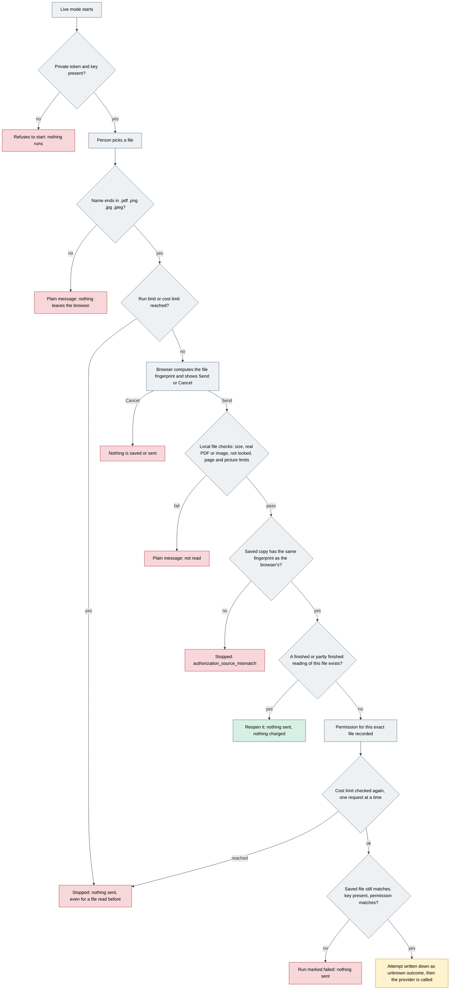

# Gate 0b: The checks before anything is sent (live mode)

[Back to the map](README.md) | Previous: [Gate 0a, free, rehearsal or live](00a-three-ways-to-run.md) | Next: [Gate 1, reading the PDF](01-reading-the-pdf.md)

## In one minute
Before a document can reach the AI provider it has to get past a row of checks, and **checks 1 to 11 in the table below can each stop the process with nothing sent**. The first checks are in the person's browser, the next ones are on the computer that runs the app, and the last ones sit right in front of the provider call. This page lists them in the order they happen. [Gate 1](01-reading-the-pdf.md) covers what is sent and what comes back.

Two things are easy to mix up. Pressing **Send** first hands the file to the app on this computer, which checks it and saves it or finds its existing record (that is where the file checks happen); the file only goes on to the provider at the very end. And the "already read" shortcut comes **after** the cost-limit check, not before it.

## How it flows

Gray is a check. Red is a stop with nothing sent. Green is the shortcut that reopens an earlier reading. Amber is the only step that sends the file.

## Worked example (invented)
In live mode, a person drops `PO-TEST-021.pdf`, a 2-page made-up order of 300 KB.
1. The name ends in `.pdf`. The browser asks the app for the counter. No prices are set in this example, so it counts runs and begins "2 of 5 live runs used"; it is not blocked.
2. The browser fingerprints the file and shows "This sends this document to OpenAI. Cost is usually a few cents. Send it?" The person presses **Send**.
3. The app on the same computer checks the file: it is not empty, under the size limit, a real unlocked PDF with 2 pages. It saves a copy under a random name and returns the fingerprint. It is the same as the browser's.
4. No earlier reading of this file exists, so a run is created with a permission record that names this fingerprint and the typed reviewer name.
5. The run counter is checked again, the saved copy is read back and its fingerprint compared, the key and permission are found. An attempt row marked "unknown outcome" is saved. Only then is the provider called.

If instead the counter had begun "5 of 5 live runs used" at step 1 (or, with prices set, the estimated spend had reached the cost cap), nothing would have been uploaded, and the page would say "The live-run limit for this demo is reached, so nothing was sent."

## The checks, in order
| # | Where | Check | If it fails |
| --- | --- | --- | --- |
| 1 | Program start | A private local token (not the shared default, at least 16 characters) and a key must be in the server's ignored settings file; the port must be free; the start script refuses to run as administrator ([`check_live_settings`, lines 24-46](https://github.com/CarlitosRed/advance-po-reader/blob/742666345a97dd00c1ed0d9e1ab725618bed3110/scripts/poc_live_support.py#L24-L46); [`poc-demo.py` lines 164-175](https://github.com/CarlitosRed/advance-po-reader/blob/a76aa4a866e2929cb3cead1109b1b9391b3e9279/scripts/poc-demo.py#L164-L175); [`start-poc-demo.ps1` lines 12-16](https://github.com/CarlitosRed/advance-po-reader/blob/742666345a97dd00c1ed0d9e1ab725618bed3110/scripts/start-poc-demo.ps1#L12-L16)) | Nothing starts |
| 2 | Browser | File name ends in `.pdf`, `.png`, `.jpg` or `.jpeg` ([`poc-demo-ui.js` line 69](https://github.com/CarlitosRed/advance-po-reader/blob/a76aa4a866e2929cb3cead1109b1b9391b3e9279/scripts/poc-demo-ui.js#L69)) | Message "Choose a PDF, PNG or JPG file." |
| 3 | Browser, asks the app | The run or cost counter is not at its limit ([lines 58-65 and 71](https://github.com/CarlitosRed/advance-po-reader/blob/a76aa4a866e2929cb3cead1109b1b9391b3e9279/scripts/poc-demo-ui.js#L58-L71)) | Stopped before the upload, even if the file was read before |
| 4 | Browser | Fingerprint (SHA-256) is computed; Send and Cancel box ([lines 72-77](https://github.com/CarlitosRed/advance-po-reader/blob/a76aa4a866e2929cb3cead1109b1b9391b3e9279/scripts/poc-demo-ui.js#L72-L77)) | Cancel clears the choice |
| 5 | The app, every change request | The request must name this computer as host (`127.0.0.1`, `localhost` or `::1`); a change request whose Origin header names another site, or that the browser marks cross-site, is refused; it must carry the private token (or the browser session and its security code); and its body may be no bigger than the upload limit plus 64 KB ([`LocalRequestBoundary`, lines 43-91](https://github.com/CarlitosRed/advance-po-reader/blob/742666345a97dd00c1ed0d9e1ab725618bed3110/backend/app.py#L43-L91); [`WebsiteSessionBoundary`](https://github.com/CarlitosRed/advance-po-reader/blob/742666345a97dd00c1ed0d9e1ab725618bed3110/backend/website.py#L37-L81)) | `loopback_host_required`, `cross_origin_mutation_denied`, `local_api_token_required`, `request_body_too_large` |
| 6 | The app, upload | Not empty; at most 10 MB; a PDF must start like a PDF, end like one, be unlocked, have 1 to 20 pages, not need repair, and decode page by page within a size budget; a picture must be a still PNG or JPEG within 8,000 pixels a side and 25 million pixels. The decoding runs in a separate short-lived process with a 15-second limit (defaults) ([`validate_file`, lines 20-36](https://github.com/CarlitosRed/advance-po-reader/blob/742666345a97dd00c1ed0d9e1ab725618bed3110/backend/uploads.py#L20-L36); [`file_validator.py`](https://github.com/CarlitosRed/advance-po-reader/blob/742666345a97dd00c1ed0d9e1ab725618bed3110/backend/file_validator.py#L8-L49); [`config.py` lines 20-24](https://github.com/CarlitosRed/advance-po-reader/blob/742666345a97dd00c1ed0d9e1ab725618bed3110/backend/config.py#L20-L24)) | A plain message such as "That PDF is password-protected." Nothing saved |
| 7 | The app, upload | The copy is saved under a random name inside the app's own private data folder; the file's own name is ignored ([`write_source`, lines 43-50](https://github.com/CarlitosRed/advance-po-reader/blob/742666345a97dd00c1ed0d9e1ab725618bed3110/backend/uploads.py#L43-L50)). A file with the same fingerprint for the same vendor and catalog reuses the earlier record instead of a second copy ([`app.py` lines 295-306](https://github.com/CarlitosRed/advance-po-reader/blob/742666345a97dd00c1ed0d9e1ab725618bed3110/backend/app.py#L295-L306)) | Storage errors stop the upload |
| 8 | Browser | The fingerprint the app returns equals the browser's (the file's record is already saved locally at this point; this upload has not created a new run yet, and earlier runs of the same file may already exist) ([line 85](https://github.com/CarlitosRed/advance-po-reader/blob/a76aa4a866e2929cb3cead1109b1b9391b3e9279/scripts/poc-demo-ui.js#L85)) | `authorization_source_mismatch` |
| 9 | Browser | An earlier reading in state `completed` or `partial` is reopened and nothing is sent ([lines 87-88](https://github.com/CarlitosRed/advance-po-reader/blob/a76aa4a866e2929cb3cead1109b1b9391b3e9279/scripts/poc-demo-ui.js#L87-L88)) | Not a failure: the shortcut |
| 10 | The app, create run | The permission record carries the same fingerprint as the stored file ([`create_run`, lines 69-71](https://github.com/CarlitosRed/advance-po-reader/blob/742666345a97dd00c1ed0d9e1ab725618bed3110/backend/service.py#L69-L71)); the live guard only accepts runs for the provider OpenAI and checks the counter again ([`install_live_guard`, lines 118-148](https://github.com/CarlitosRed/advance-po-reader/blob/742666345a97dd00c1ed0d9e1ab725618bed3110/scripts/poc_live_support.py#L118-L148)) | `authorization_source_mismatch`, `poc_live_openai_only`, `poc_spend_cap_reached` |
| 11 | The app, process run | One processing request at a time passes the counter check ([lines 125-148](https://github.com/CarlitosRed/advance-po-reader/blob/742666345a97dd00c1ed0d9e1ab725618bed3110/scripts/poc_live_support.py#L125-L148)); then the saved copy is read back and its fingerprint compared ([`process_run` line 99](https://github.com/CarlitosRed/advance-po-reader/blob/742666345a97dd00c1ed0d9e1ab725618bed3110/backend/service.py#L99); [`read_source`, lines 53-66](https://github.com/CarlitosRed/advance-po-reader/blob/742666345a97dd00c1ed0d9e1ab725618bed3110/backend/uploads.py#L53-L66)); then live mode and a key must be on, and the permission must match this file ([lines 106-120](https://github.com/CarlitosRed/advance-po-reader/blob/742666345a97dd00c1ed0d9e1ab725618bed3110/backend/service.py#L106-L120)) | The run becomes `failed` with `source_integrity_failed`, `provider_not_configured` or `external_processing_authorization_required`. Nothing sent |
| 12 | The app | The attempt is saved as "unknown outcome" and committed **before** the provider is called ([lines 127-139](https://github.com/CarlitosRed/advance-po-reader/blob/742666345a97dd00c1ed0d9e1ab725618bed3110/backend/service.py#L127-L139)) | If the program stops here, the saved attempt shows an unknown outcome, not a clean slate |

## What the cost counter really counts
From [`SpendGuard`, lines 79-115](https://github.com/CarlitosRed/advance-po-reader/blob/742666345a97dd00c1ed0d9e1ab725618bed3110/scripts/poc_live_support.py#L79-L115):
- It counts **attempts** saved in the currently selected demo database that are not marked synthetic, not only successful ones. A failed or unknown-outcome attempt counts as a used run.
- If dollar prices were supplied in the settings, it adds up the estimated cost from the usage recorded for each attempt, and blocks at the cap (default 3 dollars). An attempt with no recorded usage adds zero.
- The check happens **before** a call, so a call that is let through can still take the total past the cap.
- Without prices it counts runs against a limit (default 5). With prices, the run limit applies only if it was set on purpose.
- It reads the selected database, so a fresh demo database starts the count from zero ([`poc_demo_support.py` lines 136-139](https://github.com/CarlitosRed/advance-po-reader/blob/a76aa4a866e2929cb3cead1109b1b9391b3e9279/scripts/poc_demo_support.py#L136-L139)).

## What a person sees
- Before the upload: a counter line that begins, for example, "2 of 5 live runs used" (or "Estimated spend ..." when prices are set), and the box "Before we read it", with the file name and size, and **Send** or **Cancel**.
- On a stop: one plain sentence (for example "The live-run limit for this demo is reached, so nothing was sent.", "That PDF is password-protected. Choose an unprotected file.").
- The name on the permission record is the reviewer name typed on that device, or "POC owner" if none ([`poc-demo-ui.js` lines 51-53](https://github.com/CarlitosRed/advance-po-reader/blob/a76aa4a866e2929cb3cead1109b1b9391b3e9279/scripts/poc-demo-ui.js#L51-L53)). It is a typed name, not a login.

## Honest limits
- Nothing here proves the browser's fingerprint belongs to the file the person meant to pick; it proves the file the app saved is the file the browser fingerprinted, and that the stored file is unchanged when it is sent.
- The cost counter is an estimate based on what the provider reported; it is not an invoice.
- The one-page probe helper (`run_probe`) builds the provider adapter itself and calls it directly, not through the app's request path, so the counter's request checks do not see that call ([`poc_live_support.py` lines 223-231](https://github.com/CarlitosRed/advance-po-reader/blob/742666345a97dd00c1ed0d9e1ab725618bed3110/scripts/poc_live_support.py#L223-L231)).
- I ran none of these checks. The page comes from reading the code at the fixed commit.

## Where it lives
- [`scripts/poc_live_support.py`](https://github.com/CarlitosRed/advance-po-reader/blob/742666345a97dd00c1ed0d9e1ab725618bed3110/scripts/poc_live_support.py), [`scripts/poc-demo-ui.js`](https://github.com/CarlitosRed/advance-po-reader/blob/a76aa4a866e2929cb3cead1109b1b9391b3e9279/scripts/poc-demo-ui.js), [`scripts/poc-demo.py`](https://github.com/CarlitosRed/advance-po-reader/blob/a76aa4a866e2929cb3cead1109b1b9391b3e9279/scripts/poc-demo.py): start checks, counter, Send box.
- [`backend/app.py`](https://github.com/CarlitosRed/advance-po-reader/blob/742666345a97dd00c1ed0d9e1ab725618bed3110/backend/app.py), [`backend/uploads.py`](https://github.com/CarlitosRed/advance-po-reader/blob/742666345a97dd00c1ed0d9e1ab725618bed3110/backend/uploads.py), [`backend/file_validator.py`](https://github.com/CarlitosRed/advance-po-reader/blob/742666345a97dd00c1ed0d9e1ab725618bed3110/backend/file_validator.py), [`backend/config.py`](https://github.com/CarlitosRed/advance-po-reader/blob/742666345a97dd00c1ed0d9e1ab725618bed3110/backend/config.py): request limits and file checks.
- [`backend/service.py`](https://github.com/CarlitosRed/advance-po-reader/blob/742666345a97dd00c1ed0d9e1ab725618bed3110/backend/service.py) (`create_run`, `process_run`): permission match, integrity, attempt record.

## Built by PR
[#14](https://github.com/CarlitosRed/advance-po-reader/pull/14) (live mode, Send box, counter). The file checks, request limits and attempt record were built earlier (exact PR not verified).

## How we know it works
- Tests that exist for this area: `tests/backend/test_poc_live.py`, `tests/backend/test_service_failures.py` (names found in the repository; not re-run or read for this page).
- No measured figure applies: this gate decides whether a document may be sent, not how well it is read.

## Status
In version 1 (live checks from PR #14), not in `main` as of this writing.
