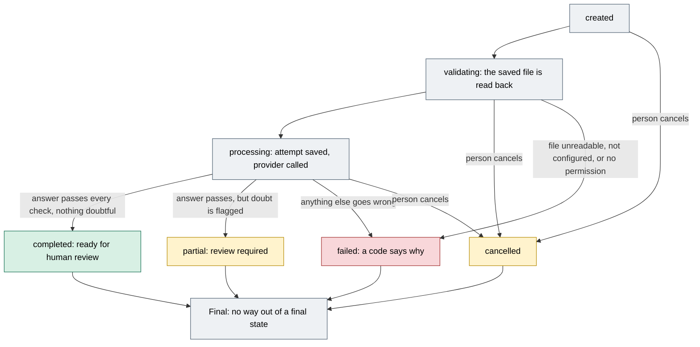

# Gate 1b: When a reading fails, stops or finishes partly

[Back to the map](README.md) | Previous: [Gate 1, reading the PDF](01-reading-the-pdf.md) | Next: [Gate 2, sorting each line](02-sorting-each-line.md)

## In one minute
Every attempt to read a file ends as one **run** with one final state: `completed`, `partial`, `failed` or `cancelled`. **A final state is never reopened.** To read the same file again, the app makes a new run (and, in live mode, a new paid attempt). Only `completed` and `partial` runs can be reviewed. Nothing here retries by itself.

This page answers three plain questions: what ends in each state, what the person sees, and when a new reading is needed (and may cost money again).

## The life of a run

Green can be reviewed as is. Amber can be reviewed (partial) or was stopped by the person (cancelled). Red is a failure. Gray is structure. The allowed moves are the ones in the table `_RUN_TRANSITIONS`; every final state has no move out ([`gate_a/contracts.py` lines 186-206](https://github.com/CarlitosRed/advance-po-reader/blob/742666345a97dd00c1ed0d9e1ab725618bed3110/gate_a/contracts.py#L186-L206)).

## What ends in each state
What `process_run` does, step by step ([`backend/service.py` lines 90-215](https://github.com/CarlitosRed/advance-po-reader/blob/742666345a97dd00c1ed0d9e1ab725618bed3110/backend/service.py#L90-L215)):

| What happened | Final state and code | Reviewable? | New reading needed? |
| --- | --- | --- | --- |
| The saved file cannot be read back, or no longer matches its fingerprint | `failed`, a storage or integrity code ([lines 98-105](https://github.com/CarlitosRed/advance-po-reader/blob/742666345a97dd00c1ed0d9e1ab725618bed3110/backend/service.py#L98-L105)) | No | Yes, after the file problem is dealt with |
| Live mode is off, or no key; or no permission for this exact file | `failed`, `provider_not_configured` or `external_processing_authorization_required` ([lines 106-120](https://github.com/CarlitosRed/advance-po-reader/blob/742666345a97dd00c1ed0d9e1ab725618bed3110/backend/service.py#L106-L120)); nothing sent | No | Yes (a new run with the missing piece) |
| The provider reports a failure, a refusal or an unfinished answer | `failed`, the provider's error code ([lines 176-178](https://github.com/CarlitosRed/advance-po-reader/blob/742666345a97dd00c1ed0d9e1ab725618bed3110/backend/service.py#L176-L178)) | No | Yes |
| The answer names a different model, prompt or schema version than the attempt was saved with | `failed`, `provider_version_mismatch` ([lines 166-169](https://github.com/CarlitosRed/advance-po-reader/blob/742666345a97dd00c1ed0d9e1ab725618bed3110/backend/service.py#L166-L169)) | No | Yes |
| The answer breaks the strict check | `failed`, `invalid_extraction_payload` ([lines 180-186](https://github.com/CarlitosRed/advance-po-reader/blob/742666345a97dd00c1ed0d9e1ab725618bed3110/backend/service.py#L180-L186)); the provider adapter can also reject it earlier with `provider_payload_validation_failed` ([gate 1](01-reading-the-pdf.md)) | No | Yes |
| The answer is valid but says the document is not a purchase order | `failed`, `unsupported_document_type` (model said "unsupported") or `needs_classification` (model said "unknown"). The answer is stored on the run, but review refuses a failed run ([lines 188-192](https://github.com/CarlitosRed/advance-po-reader/blob/742666345a97dd00c1ed0d9e1ab725618bed3110/backend/service.py#L188-L192); [`review_run` line 232](https://github.com/CarlitosRed/advance-po-reader/blob/742666345a97dd00c1ed0d9e1ab725618bed3110/backend/service.py#L232)) | No | Yes, if the file is not what it looked like |
| The call is interrupted by an unexpected error | `failed`, `unknown_outcome`; the attempt keeps `provider_outcome_unknown` and the provider may already have charged ([lines 140-154](https://github.com/CarlitosRed/advance-po-reader/blob/742666345a97dd00c1ed0d9e1ab725618bed3110/backend/service.py#L140-L154)) | No | A person decides; the app does not retry |
| The program stops during the call | The attempt stays "unknown outcome"; the run stays `processing`. Asking to process it again answers `processing_in_progress_or_unknown_outcome` ([lines 94-95](https://github.com/CarlitosRed/advance-po-reader/blob/742666345a97dd00c1ed0d9e1ab725618bed3110/backend/service.py#L94-L95), [127-139](https://github.com/CarlitosRed/advance-po-reader/blob/742666345a97dd00c1ed0d9e1ab725618bed3110/backend/service.py#L127-L139)) | No | Not decided by the code; the screen says to check the saved status before continuing |
| The answer is valid and nothing is doubtful | `completed`, `ready_for_human_review` ([lines 211-212](https://github.com/CarlitosRed/advance-po-reader/blob/742666345a97dd00c1ed0d9e1ab725618bed3110/backend/service.py#L211-L212)) | Yes | No |
| The answer is valid but marked **partial**: a page not read completely, a warning, a line the model could not classify (unknown), a line with a stated doubt, or a header or line value marked uncertain or unreadable; **or** it holds no product line at all; **or** one line's catalog search was too big to run | `partial`, `review_required` ([`ExtractionPayload.partial`](https://github.com/CarlitosRed/advance-po-reader/blob/742666345a97dd00c1ed0d9e1ab725618bed3110/backend/contracts.py#L238-L253), [`service.py` lines 194-209](https://github.com/CarlitosRed/advance-po-reader/blob/742666345a97dd00c1ed0d9e1ab725618bed3110/backend/service.py#L194-L209)) | Yes. Lines still go to the tabs; Finish needs a person to acknowledge a partly read page and any warnings ([gate 6](06-decisions-and-saved-data.md)) | A person may choose one |

## Stopping a run on purpose
- A person can cancel a run that is `created`, `validating` or `processing`; cancelling a run that is already `completed`, `partial` or `failed` is refused with `terminal_run_cannot_cancel` ([`cancel_run`, lines 218-227](https://github.com/CarlitosRed/advance-po-reader/blob/742666345a97dd00c1ed0d9e1ab725618bed3110/backend/service.py#L218-L227)). Cancelling a run that is already cancelled just returns it.
- If the provider call was already under way, its answer is still recorded as attempt information (model, usage, request ids), but the readings are thrown away and the run stays `cancelled` ([lines 172-175](https://github.com/CarlitosRed/advance-po-reader/blob/742666345a97dd00c1ed0d9e1ab725618bed3110/backend/service.py#L172-L175)).
- The app does not claim the remote request stopped. Its own message says a request already submitted may still finish ([`errorText` in `web/local-reader/app.js`](https://github.com/CarlitosRed/advance-po-reader/blob/742666345a97dd00c1ed0d9e1ab725618bed3110/web/local-reader/app.js#L6)). The "Cancel run" button is shown while a run is being read ([`workflow.js` lines 329-341](https://github.com/CarlitosRed/advance-po-reader/blob/742666345a97dd00c1ed0d9e1ab725618bed3110/web/local-reader/workflow.js#L329-L341)).

## When a new reading is needed, and what it costs
- **A finished reading is reopened, not repeated.** On the upload page, if the file already has a `completed` or `partial` run, the page opens it and sends nothing ([`poc-demo-ui.js` lines 86-87](https://github.com/CarlitosRed/advance-po-reader/blob/742666345a97dd00c1ed0d9e1ab725618bed3110/scripts/poc-demo-ui.js#L86-L87)). Asking the server to process a run that is already final returns it unchanged and calls no provider ([`service.py` lines 92-93](https://github.com/CarlitosRed/advance-po-reader/blob/742666345a97dd00c1ed0d9e1ab725618bed3110/backend/service.py#L92-L93)).
- **After `failed` or `cancelled`, uploading the same file again makes a new run.** The upload page only looks for `completed` or `partial` runs, and it creates the next run with a fresh key ([lines 83-92](https://github.com/CarlitosRed/advance-po-reader/blob/742666345a97dd00c1ed0d9e1ab725618bed3110/scripts/poc-demo-ui.js#L83-L92)). In live mode that run makes a new attempt, which the cost counter counts ([gate 0b](00b-checks-before-sending.md)).
- **Sending the same run request twice does not make two runs**: the same key with the same content returns the first run; the same key with different content is refused with `idempotency_payload_conflict` ([`create_run`, lines 62-68](https://github.com/CarlitosRed/advance-po-reader/blob/742666345a97dd00c1ed0d9e1ab725618bed3110/backend/service.py#L62-L68)).
- **Past answers stay.** Earlier runs, their attempts and their review events are not deleted; a new run starts a new review ([`review_run` line 245](https://github.com/CarlitosRed/advance-po-reader/blob/742666345a97dd00c1ed0d9e1ab725618bed3110/backend/service.py#L245): a finished review accepts no new answers).

## Worked example (invented)
File `PO-TEST-022.pdf`, 2 pages, live mode.
1. First Send: the provider answers, but page 2 declares a rectangle named `r4` twice. The strict check rejects it. The run is `failed`, and the person reads "The reading came back in a shape we could not check. Try another file."
2. The person drops the same file again. There is no `completed` or `partial` run, so the app creates run 2 and tries again. The cost counter now shows two attempts.
3. Run 2 passes the check, but the model flagged page 2 as only partly read. The run is `partial`. Its lines show on the tabs. The Summary offers "I checked this page" for page 2, which Finish needs.
4. A third drop of the same file reopens run 2 and sends nothing.

## What a person sees
- A failure: one plain sentence for that code ([`POC_MESSAGES` in `scripts/poc-demo-ui.js`](https://github.com/CarlitosRed/advance-po-reader/blob/742666345a97dd00c1ed0d9e1ab725618bed3110/scripts/poc-demo-ui.js#L10-L32)), and no partial lines.
- A run still being read: a status badge that refreshes, with "Refresh status" and "Cancel run" ([`workflow.js` lines 329-341](https://github.com/CarlitosRed/advance-po-reader/blob/742666345a97dd00c1ed0d9e1ab725618bed3110/web/local-reader/workflow.js#L329-L341)).
- A partial run: the normal tabs, plus the "partly read" notices on the Summary ([gate 6](06-decisions-and-saved-data.md)).

## Honest limits
- I did not run any of these paths. The page comes from reading the code at the fixed commit.
- Which failure codes the live provider has produced in practice is not counted here; the figures in the [map](README.md) are for a batch of accepted readings only.
- The code does not say what to do with a run left in `processing` after a crash; the table states only what the code does and what the screen says.
- The batch figure "33 of 33" counts readings accepted for review, five of them `partial`; it is not a count of fully `completed` runs.

## Where it lives
- [`backend/service.py`](https://github.com/CarlitosRed/advance-po-reader/blob/742666345a97dd00c1ed0d9e1ab725618bed3110/backend/service.py): `create_run`, `process_run`, `cancel_run`.
- [`gate_a/contracts.py`](https://github.com/CarlitosRed/advance-po-reader/blob/742666345a97dd00c1ed0d9e1ab725618bed3110/gate_a/contracts.py): the allowed run state moves.
- [`scripts/poc-demo-ui.js`](https://github.com/CarlitosRed/advance-po-reader/blob/742666345a97dd00c1ed0d9e1ab725618bed3110/scripts/poc-demo-ui.js): reuse of a finished reading, new run after a failure, failure messages.
- [`web/local-reader/workflow.js`](https://github.com/CarlitosRed/advance-po-reader/blob/742666345a97dd00c1ed0d9e1ab725618bed3110/web/local-reader/workflow.js): the "being read" panel and Cancel run.

## Built by PR
The run states and the single-attempt flow were built before the PRs listed in this folder (exact PR not verified). [#14](https://github.com/CarlitosRed/advance-po-reader/pull/14) added the live upload page and its messages; [#15](https://github.com/CarlitosRed/advance-po-reader/pull/15) lets unknown lines pass the check.

## How we know it works
- Tests that exist for this area: `tests/backend/test_service_failures.py`, `tests/backend/test_poc_live.py` (names found in the repository; not re-run or read for this page).
- No measured figure applies.

## Status
In version 1 (the states and flows come from the base code; the upload-page behavior is from PR #14), not in `main` as of this writing.
