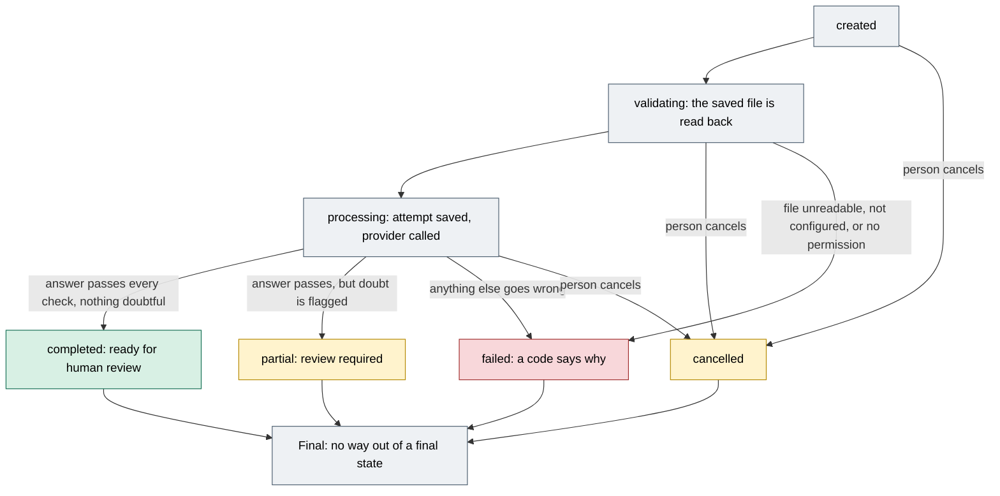

# Gate 1b: When a reading fails, stops or finishes partly

[Back to the map](README.md) | Previous: [Gate 1, reading the PDF](01-reading-the-pdf.md) | Next: [Gate 2, sorting each line](02-sorting-each-line.md)

## In one minute
A reading of a file is one **run**. A run normally ends in one of four final states: `completed`, `partial`, `failed` or `cancelled` (a run can also be left in `processing` if the program stops mid-call, see below). **The code has no move out of a final state** ([`gate_a/contracts.py`](https://github.com/CarlitosRed/advance-po-reader/blob/742666345a97dd00c1ed0d9e1ab725618bed3110/gate_a/contracts.py#L186-L206)). Only `completed` and `partial` runs can be reviewed. `process_run` makes one provider attempt per run and does not retry.

This page answers three plain questions: what ends in each state, what the person sees, and when the demo upload page makes a new run (which in live mode may cost money again).

## The life of a run

Green can be reviewed as is. Amber can be reviewed (partial) or was stopped by the person (cancelled). Red is a failure. Gray is structure. The allowed moves are the ones in the table `_RUN_TRANSITIONS`; every final state has no move out ([`gate_a/contracts.py` lines 186-206](https://github.com/CarlitosRed/advance-po-reader/blob/742666345a97dd00c1ed0d9e1ab725618bed3110/gate_a/contracts.py#L186-L206)).

## What ends in each state
What `process_run` does, step by step ([`backend/service.py` lines 90-215](https://github.com/CarlitosRed/advance-po-reader/blob/742666345a97dd00c1ed0d9e1ab725618bed3110/backend/service.py#L90-L215)):

| What happened | Final state and code | Reviewable? | Does this run need replacing? |
| --- | --- | --- | --- |
| The saved file cannot be read back, or no longer matches its fingerprint | `failed`, a storage or integrity code ([lines 98-105](https://github.com/CarlitosRed/advance-po-reader/blob/742666345a97dd00c1ed0d9e1ab725618bed3110/backend/service.py#L98-L105)) | No | Yes, after the file problem is dealt with |
| For a run that uses the OpenAI provider: live mode is off or there is no key (checked first, unless the program supplies its own provider, as the rehearsal does); or the permission record does not match this exact file | `failed`, `provider_not_configured` or `external_processing_authorization_required` ([lines 106-120](https://github.com/CarlitosRed/advance-po-reader/blob/742666345a97dd00c1ed0d9e1ab725618bed3110/backend/service.py#L106-L120)); nothing sent | No | Yes (a new run with the missing piece) |
| The provider reports a failure, a refusal or an unfinished answer | `failed`, the provider's error code, or its state name if it gave none ([lines 176-178](https://github.com/CarlitosRed/advance-po-reader/blob/742666345a97dd00c1ed0d9e1ab725618bed3110/backend/service.py#L176-L178)) | No | Yes |
| The returned schema version is not one of the two supported ones (`1.1`, `1.2`), or the returned model name or prompt version differs from what the attempt saved before the call (the schema version is **not** compared with the attempt's saved one) | `failed`, `provider_version_mismatch` ([lines 166-169](https://github.com/CarlitosRed/advance-po-reader/blob/742666345a97dd00c1ed0d9e1ab725618bed3110/backend/service.py#L166-L169)) | No | Yes |
| The answer breaks the strict check | `failed`, `invalid_extraction_payload` ([lines 180-186](https://github.com/CarlitosRed/advance-po-reader/blob/742666345a97dd00c1ed0d9e1ab725618bed3110/backend/service.py#L180-L186)); the provider adapter can also reject it earlier with `provider_payload_validation_failed` ([gate 1](01-reading-the-pdf.md)) | No | Yes |
| The answer is valid but says the document is not a purchase order | `failed`, `unsupported_document_type` (model said "unsupported") or `needs_classification` (model said "unknown"). The answer is stored on the run, but review refuses a failed run ([lines 188-192](https://github.com/CarlitosRed/advance-po-reader/blob/742666345a97dd00c1ed0d9e1ab725618bed3110/backend/service.py#L188-L192); [`review_run` line 232](https://github.com/CarlitosRed/advance-po-reader/blob/742666345a97dd00c1ed0d9e1ab725618bed3110/backend/service.py#L232)) | No | A person decides; the code does not |
| The call is interrupted by an unexpected error (if the run was cancelled meanwhile, it stays `cancelled`) | `failed`, `unknown_outcome`; the attempt keeps `provider_outcome_unknown` and the provider may already have charged ([lines 140-154](https://github.com/CarlitosRed/advance-po-reader/blob/742666345a97dd00c1ed0d9e1ab725618bed3110/backend/service.py#L140-L154)) | No | A person decides; the app does not retry |
| The program stops after the attempt was saved and before the run was finished | The attempt stays "unknown outcome"; the run stays `processing`. Asking to process it again answers `processing_in_progress_or_unknown_outcome` ([lines 94-95](https://github.com/CarlitosRed/advance-po-reader/blob/742666345a97dd00c1ed0d9e1ab725618bed3110/backend/service.py#L94-L95), [127-139](https://github.com/CarlitosRed/advance-po-reader/blob/742666345a97dd00c1ed0d9e1ab725618bed3110/backend/service.py#L127-L139)) | No | The code does not retry. A person can cancel such a run (it is not final), and the screen says to check the saved status before continuing |
| The answer is valid and nothing is doubtful | `completed`, `ready_for_human_review` ([lines 211-212](https://github.com/CarlitosRed/advance-po-reader/blob/742666345a97dd00c1ed0d9e1ab725618bed3110/backend/service.py#L211-L212)) | Yes | No |
| The answer is valid but marked **partial**: a page not read completely, a warning, a line the model could not classify (unknown), a line with a stated doubt, or a document number, vendor name, currency, or a line's code, description, quantity, unit, price or total marked uncertain or unreadable; **or** it holds no product line at all; **or** one line's catalog search was refused by its limits (for example too many printed codes on one line) | `partial`, `review_required` ([`ExtractionPayload.partial`](https://github.com/CarlitosRed/advance-po-reader/blob/742666345a97dd00c1ed0d9e1ab725618bed3110/backend/contracts.py#L238-L253), [`service.py` lines 194-209](https://github.com/CarlitosRed/advance-po-reader/blob/742666345a97dd00c1ed0d9e1ab725618bed3110/backend/service.py#L194-L209)) | Yes. Lines still go to the tabs; if a page was only partly read or the reading carries warnings, a person must acknowledge them before Finish ([gate 6](06-decisions-and-saved-data.md)) | A person may choose one |

## Stopping a run on purpose
- A person can cancel a run that is `created`, `validating` or `processing`; cancelling a run that is already `completed`, `partial` or `failed` is refused with `terminal_run_cannot_cancel` ([`cancel_run`, lines 218-227](https://github.com/CarlitosRed/advance-po-reader/blob/742666345a97dd00c1ed0d9e1ab725618bed3110/backend/service.py#L218-L227)). Cancelling a run that is already cancelled just returns it.
- If the provider call was already under way, its answer is still recorded as attempt information (model, usage, request ids), but the readings are thrown away and the run stays `cancelled` ([lines 172-175](https://github.com/CarlitosRed/advance-po-reader/blob/742666345a97dd00c1ed0d9e1ab725618bed3110/backend/service.py#L172-L175)).
- The app does not claim the remote request stopped. Its own message says a request already submitted may still finish ([`errorText` in `web/local-reader/app.js`](https://github.com/CarlitosRed/advance-po-reader/blob/742666345a97dd00c1ed0d9e1ab725618bed3110/web/local-reader/app.js#L6)). In the review web app, a "Cancel run" button is shown while a run is being read or prepared ([`workflow.js` lines 329-341](https://github.com/CarlitosRed/advance-po-reader/blob/742666345a97dd00c1ed0d9e1ab725618bed3110/web/local-reader/workflow.js#L329-L341)).

## When a new reading is needed, and what it costs
- **A finished reading is reopened, not repeated.** On the demo upload page, if the file's saved record already has a `completed` or `partial` run, the page opens the last such run and sends nothing, once the drop-time checks have passed (file type, and neither the run limit nor the cost limit reached; those checks come first; the record is per vendor and catalog, so the same bytes chosen for another vendor are a different record) ([`poc-demo-ui.js` lines 86-87](https://github.com/CarlitosRed/advance-po-reader/blob/742666345a97dd00c1ed0d9e1ab725618bed3110/scripts/poc-demo-ui.js#L86-L87)). Asking the server to process a run that is already final returns it unchanged and calls no provider ([`service.py` lines 92-93](https://github.com/CarlitosRed/advance-po-reader/blob/742666345a97dd00c1ed0d9e1ab725618bed3110/backend/service.py#L92-L93)).
- **The demo upload page makes a new run only when no `completed` or `partial` run exists for that file.** It first looks through all saved runs of the file and reopens the last `completed` or `partial` one, even if a newer run failed or was cancelled; only if there is none does it create a run, with a fresh key ([lines 83-92](https://github.com/CarlitosRed/advance-po-reader/blob/742666345a97dd00c1ed0d9e1ab725618bed3110/scripts/poc-demo-ui.js#L83-L92)). Whether that new run reaches the provider still depends on the run-limit, cost-limit and send checks passing ([gate 0b](00b-checks-before-sending.md)); if it does, it makes a new attempt, which the cost counter counts.
- **Repeating a run request with the same key does not make a second run**: the same key with the same content returns the first run; the same key with different content is refused with `idempotency_payload_conflict` ([`create_run`, lines 62-68](https://github.com/CarlitosRed/advance-po-reader/blob/742666345a97dd00c1ed0d9e1ab725618bed3110/backend/service.py#L62-L68)).
- **Past answers stay.** `create_run`, `process_run` and `cancel_run` delete no earlier run, attempt or review event, and review events are protected in the database against change ([gate 6](06-decisions-and-saved-data.md)). A new run starts with its own review state; a finished review accepts no new answers, except that an exact repeat of an earlier new-product save returns that earlier event ([`review_run` lines 238-246](https://github.com/CarlitosRed/advance-po-reader/blob/742666345a97dd00c1ed0d9e1ab725618bed3110/backend/service.py#L238-L246)).

## Worked example (invented)
File `PO-TEST-022.pdf`, 2 pages, live mode.
1. First Send: the provider answers, but page 2 declares a rectangle named `r4` twice. The provider adapter's strict check rejects it. The run is `failed`, and the person reads "The reading came back in a shape we could not check. Try another file."
2. The person drops the same file again. Neither the run limit nor the cost limit has been reached, and there is no `completed` or `partial` run for the file, so, once the person presses Send, the upload page creates run 2 and tries again. The cost counter now shows two attempts.
3. Run 2 passes the check, but the model flagged page 2 as only partly read. The run is `partial`. Its lines show on the tabs. The Summary offers "I checked this page" for page 2, which Finish needs.
4. A third drop of the same file reopens run 2 and sends nothing (as long as neither the run limit nor the cost limit has been reached, because those checks come first).

## What a person sees
- A failure: one plain sentence for that code ([`POC_MESSAGES` in `scripts/poc-demo-ui.js`](https://github.com/CarlitosRed/advance-po-reader/blob/742666345a97dd00c1ed0d9e1ab725618bed3110/scripts/poc-demo-ui.js#L10-L32)), or a generic "Something went wrong" when the code has no message of its own; no lines are shown.
- A run still being read: a status badge, with "Refresh status" and "Cancel run" ([`workflow.js` lines 329-341](https://github.com/CarlitosRed/advance-po-reader/blob/742666345a97dd00c1ed0d9e1ab725618bed3110/web/local-reader/workflow.js#L329-L341)).
- A partial run: the normal tabs, plus the "partly read" notices on the Summary ([gate 6](06-decisions-and-saved-data.md)).

## Honest limits
- I did not run any of these paths. The page comes from reading the code at the fixed commit.
- Which failure codes the live provider has produced in practice is not counted here; the figures in the [map](README.md) are for a batch of accepted readings only.
- The code does not say what to do with a run left in `processing` after a crash; the table states only what the code does and what the screen says.
- The batch figure "33 of 33" counts readings accepted for review, five of them `partial`; it is not a count of fully `completed` runs.

## Where it lives
- [`backend/service.py`](https://github.com/CarlitosRed/advance-po-reader/blob/742666345a97dd00c1ed0d9e1ab725618bed3110/backend/service.py): `create_run`, `process_run`, `cancel_run`.
- [`gate_a/contracts.py`](https://github.com/CarlitosRed/advance-po-reader/blob/742666345a97dd00c1ed0d9e1ab725618bed3110/gate_a/contracts.py): the allowed run state moves.
- [`scripts/poc-demo-ui.js`](https://github.com/CarlitosRed/advance-po-reader/blob/742666345a97dd00c1ed0d9e1ab725618bed3110/scripts/poc-demo-ui.js): reuse of a finished reading, new run after a failure, failure messages.
- [`web/local-reader/workflow.js`](https://github.com/CarlitosRed/advance-po-reader/blob/742666345a97dd00c1ed0d9e1ab725618bed3110/web/local-reader/workflow.js): the "being read" panel and Cancel run.

## Built by PR
The run states and the single-attempt flow were built before the PRs listed in this folder (exact PR not verified). [#14](https://github.com/CarlitosRed/advance-po-reader/pull/14) added the live upload page and its messages; [#15](https://github.com/CarlitosRed/advance-po-reader/pull/15) lets unknown lines pass the check.

## How we know it works
- Tests that exist for this area: `tests/backend/test_service_failures.py`, `tests/backend/test_poc_live.py` (names found in the repository; not re-run or read for this page).
- No measured figure applies.

## Status
In version 1 (the states and flows come from the base code; the upload-page behavior is from PR #14), not in `main` as of this writing.
