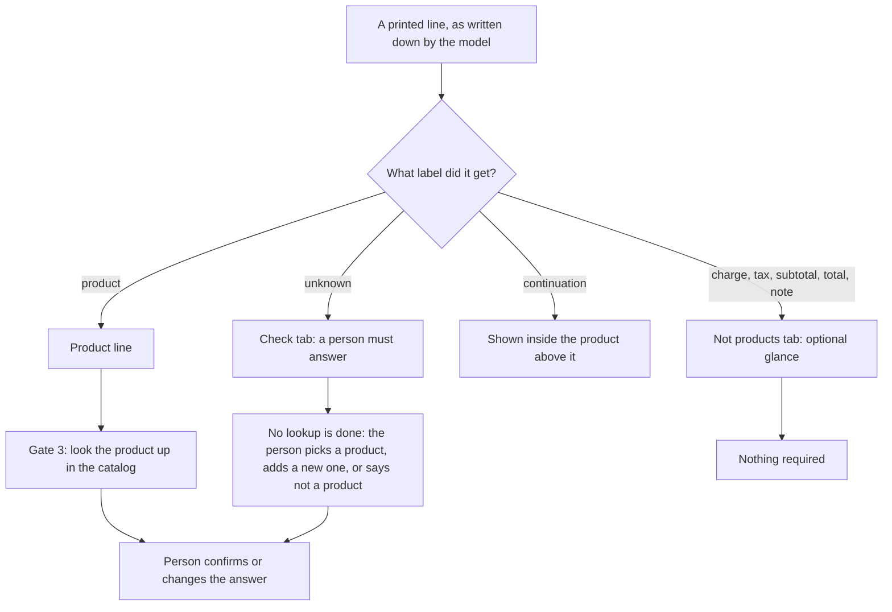

# Gate 2: Sorting each line (product, or total / note / charge / tax)

[Back to the map](README.md) | Previous: [Gate 1](01-reading-the-pdf.md) | Next: [Gate 3, finding the product](03-finding-the-product.md)

## In one minute
Not every printed line is something we sell. Orders also print subtotals, shipping, taxes and notes ("deliver to dock 4"). Before any product is looked up, each line gets a label from the AI model (gate 1), and the app uses that label to decide what happens to the line:

- **Product line:** goes on to the product lookup and **must be answered by a person**.
- **Total, subtotal, charge, tax or note:** never looked up, never required. It is shown in an optional tab (**Not products** in this base; the draft PR #21, head `e1088a0`, renames it **Ignored lines** and shows "optional" instead of a "to review" count; coming in PR #21, not in this base).
- **Continuation:** a wrapped second line of a description. It is shown together with the product above it and is not a line of its own.
- **Unknown:** the model could not tell. It must say why. It goes to the **Check** tab and a person must answer it.

A person can also say "this is not a product" for a line the model called a product, and it moves to the same optional tab.

## How a line is sorted

## Worked example (invented)
Order `PO-TEST-002` as the model wrote it down:

| # | Printed | Label | What happens |
| --- | --- | --- | --- |
| 1 | `ACME-1001  Brass hinge 50mm  20` | product | Looked up in the catalog (gate 3) |
| 2 | `with 4 screws per hinge` (wrapped, directly below line 1) | continuation | Shown as part of line 1's description |
| 3 | `Freight charge  12.00` | charge | Not products tab |
| 4 | `Subtotal  240.00` | subtotal | Not products tab |
| 5 | `Please deliver to dock 4` | note | Not products tab |
| 6 | `AC?E-?00?  smudged  5` | unknown, reason "unclassified text" | Check tab, no suggestion, person answers |

The person has to answer lines 1 and 6. Lines 3, 4 and 5 can be ignored without blocking the finish.

## What a person sees
- Product lines are numbered "Line 1", "Line 2" and so on; the optional lines are called "Printed line".
- A continuation never gets its own card; its text appears under the product.
- In **Not products** each system-labelled line shows "Read as" (Charge, Tax, Subtotal, Total, Note), the printed text and the amount. Two buttons: **Agree, not a product**, or **Actually a product**.
- **Honest limit:** those two buttons are remembered only on this device (browser storage). The server cannot yet change a line's label, so a line flagged "Actually a product" is **not** added to the spreadsheet, and the page says so. (`web/local-reader/workflow.js`, `handleTabAction` and the "Flagged on this device only" text.)
- Product lines that a person marked "Not a product" go to the same tab with the name of who marked it.

## Rules behind it (checked in code)
- The model's labels must be consistent: a product line has the row kind "product" and the role "product_item"; totals, charges, taxes, subtotals and notes have the role "document_detail" and no group; an unknown line must carry a reason (`ExtractedRow.row_semantics`, `backend/contracts.py`). A contradiction rejects the whole answer ([gate 1](01-reading-the-pdf.md)).
- The catalog lookup runs only for rows whose kind is "product" (`process_run`, `backend/service.py`).
- The review step (`review_suggestions`, `backend/tiers.py`) and the finish rule (`resolution_blockers`, `backend/review_summary.py`) work on lines whose role is product item or unknown. A "document detail" line can never be approved, excluded or classified as a product through the server: the server refuses with `document_detail_does_not_require_product_review` or `document_detail_cannot_be_classified_as_product` (`backend/service.py`, `backend/review_answers.py`).
- An unknown line has no stored suggestion, so the review step creates an empty one: no candidate, tier Uncertain, reason "Unknown source row requires an explicit three-way decision". "No match" is not accepted for it; the person must pick a product, add a new one, or say "not a product" (`uncertain_requires_three_way_decision`).
- Older answers (schema 1.1) have no roles; the code derives them from the kind (`effective_row_role`).

## Where it lives
- Labels and consistency rules: [`backend/contracts.py`](https://github.com/CarlitosRed/advance-po-reader/blob/742666345a97dd00c1ed0d9e1ab725618bed3110/backend/contracts.py) (`ExtractedRow`, `ExtractionPayload._validate_item_groups`).
- Prompt wording for labels and continuations: [`backend/providers.py`](https://github.com/CarlitosRed/advance-po-reader/blob/742666345a97dd00c1ed0d9e1ab725618bed3110/backend/providers.py) (`EXTRACTION_PROMPT`, rules 4 to 7).
- Who needs an answer: [`backend/review_summary.py`](https://github.com/CarlitosRed/advance-po-reader/blob/742666345a97dd00c1ed0d9e1ab725618bed3110/backend/review_summary.py) (`effective_row_role`, `resolution_blockers`), [`backend/tiers.py`](https://github.com/CarlitosRed/advance-po-reader/blob/742666345a97dd00c1ed0d9e1ab725618bed3110/backend/tiers.py) (`review_suggestions`).
- Tab placement: [`web/local-reader/workflow.js`](https://github.com/CarlitosRed/advance-po-reader/blob/742666345a97dd00c1ed0d9e1ab725618bed3110/web/local-reader/workflow.js) (`rowRoleOf`, `assignTabs`).

## Built by PR
[#15](https://github.com/CarlitosRed/advance-po-reader/pull/15) (unknown lines must carry a reason, so they pass the strict check); [#16](https://github.com/CarlitosRed/advance-po-reader/pull/16) (the three tabs, including Not products); [#7](https://github.com/CarlitosRed/advance-po-reader/pull/7) (explicit answers for unclear lines). PR [#21](https://github.com/CarlitosRed/advance-po-reader/pull/21) (not in this base) renames the tab and makes it optional. The row kinds and roles themselves were built earlier (exact PR not verified).

## How we know it works
- Tests: `tests/goal/test_goal_tabs.py` (every line is placed in exactly one tab), `tests/goal/test_goal_tabs_data.py` and `tests/backend/test_poc_demo_tabs.py` (a sample with every kind of line fills all three tabs), `tests/backend/test_review_summary.py` (document details no longer need an answer).
- Reviews: #16 Approved at `906dbef` by Codex; #15 Approved at `2d038c8`.
- Measured on the 33 sample orders (from `decisions.md`, 2026-10-06): about 155 notes, totals, subtotals, charges and taxes were found in all, and none of them is in the must-answer list; the 150 product lines are. This count comes from stored runs, categories only; no human audited each label.
- Not measured: how often the model calls a real product a note, or the reverse.

## Status
In version 1 (the Not products tab). The "Ignored lines" name and the "optional" wording are coming in PR #21 (head `e1088a0`, still in review), which is part of the version 1 scope but not in this base. I read its diff: it leaves the two buttons and the "flagged on this device only" behaviour on these lines unchanged.
