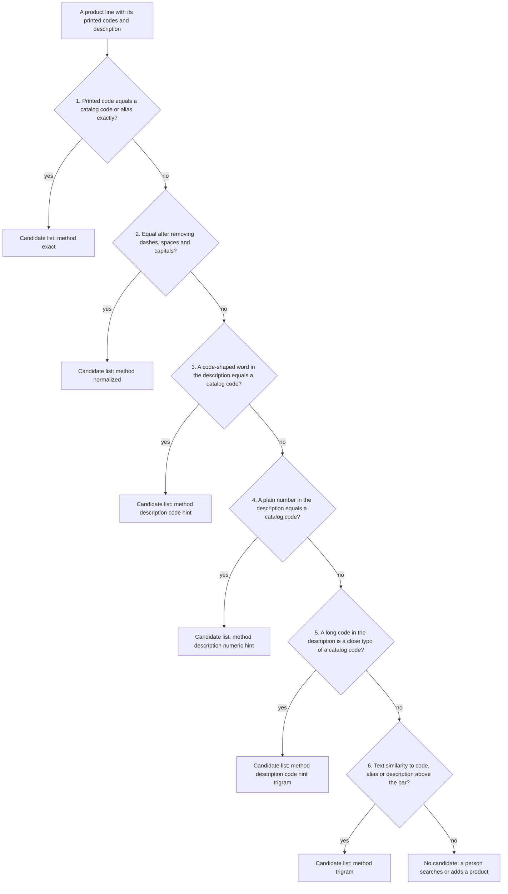

# Gate 3: Finding the product in our catalog

[Back to the map](README.md) | Previous: [Gate 2](02-sorting-each-line.md) | Next: [Gate 4, confidence tiers](04-confidence-tiers.md)

## In one minute
For every product line, the app looks for matching products **only inside our own catalog**. It tries the strongest kind of evidence first and stops at the first kind that finds anything:

1. the printed code equals a catalog code exactly (or a saved alias of one);
2. the same, ignoring dashes, spaces and capitals;
3. a code-shaped word inside the description equals a catalog code;
4. a plain number inside the description equals a catalog code (with safety rules so quantities, dates and prices are not mistaken for codes);
5. a code in the description that is very close to a catalog code (a typo);
6. the text is similar to a product's code, alias or description.

The result is a short list of **candidates** (at most 5 by default): none, exactly one, or several. The app never picks outside the list, never changes what was printed, and never approves anything. How sure the app is about that list is decided separately in [gate 4](04-confidence-tiers.md).

## How the lookup steps run

The first step that finds anything ends the search. One hit means "suggested", several hits mean "ambiguous", none means "no match" (`_result` in `backend/catalog.py`).

## Worked example (invented)
Catalog: `ACME-1001` Brass hinge 50mm (alias `HNG-50`, saved under the role "other"); `ACME-1002` Brass hinge 75mm; `ACME-2001` Steel bolt M8x40, box of 100.

| Printed line | Step that fires | Candidates |
| --- | --- | --- |
| Code column `ACME-1001`, role "vendor product code" | 1, exact | ACME-1001 |
| Code `HNG-50`, role "other" | 1, exact, through the alias | ACME-1001 |
| Code `acme 1001` | 2, normalized | ACME-1001 |
| No code. Description "Hinge, see item ACME-2001" | 3, description code hint | ACME-2001 |
| No code. Description "Brass hinge 50 mm" | 6, text similarity | possibly ACME-1001 and ACME-1002 (two, so "ambiguous") |
| Code `ZZZ-9999`, nothing similar | none | no candidate |

Role matters: step 1 and 2 look at a printed code as a product code only when the model labelled it vendor product code, SKU or vendor SKU. A code the model labelled "line number" or "other" is only compared with saved aliases of the same role. This is why PR #18 teaches the model the role list: before it, the model copied the column heading into the role field, all 27 product lines of the five test orders then fell through to text similarity, and none was "Certain" (`decisions.md`, 2026-10-06).

## Vendor prefix and a second printed code
Some lines print two codes, for example `ACME-1001` and `ZED ACME-1001`. Finding the product is still step 1 (the literal `ACME-1001` hits). What the second code means is judged afterwards, in the confidence tier ([gate 4](04-confidence-tiers.md)): letters in front of a code that name the supplier (`ZED`) are harmless; a second code that is **another product in our catalog** is a conflict; a second code that is in no catalog (a customer's own number) is set aside and noted. Those rules are PR #19.

## Safety rules of the lookup (verified in `backend/catalog.py`)
- Scope: only the tenant's own active products, inside the vendor or catalog pool chosen for the run. A pool candidate must trace back to a source namespace.
- Exact printed text comes first; normalized forms are search keys only and are never written back over what was printed.
- Description code words must have at least 4 letters or digits after cleaning, at least 2 letters and at least 2 digits, and at most 10 are used per line.
- A plain number in the description (4 to 12 digits) is **ignored** when it looks like a year (1900 to 2099), a date, a money amount (`$`, `USD`...), a quantity or unit ("x 12", "each", "qty"), or a line, row, lot or sequence number.
- Typo recovery only for code words of 8 or more characters, with a similarity of at least 0.65.
- Text similarity: code or alias at least 0.45, description at least 0.35. It needs the database add-on `pg_trgm`; without it the result is "no candidate" and a note says so, never a guess.
- At most 20 printed codes per line are queried; a line that exceeds the bound gets no candidate and is marked for human review.
- The candidate list is saved as a snapshot (`Suggestion` records, append-only) when the run is processed. The review screen never searches the catalog again for its suggestions.

## What a person sees
- **Sure** tab: one product, labelled "Matches the printed code".
- **Check** tab: the best guess and up to 2 more candidates ("Also possible"), or "No suggestion. Search the catalog, or mark the line as not a product."
- A search box on the card (by code or name) and **Not in the catalog? Add a new product**. A product added by a reviewer is labelled "Added by a reviewer" and is scoped to that run's catalog.

## Where it lives
- `backend/catalog.py`: `retrieve_candidates` (the six steps), `_description_code_hints`, `_numeric_description_code_hints`, `normalize_identifier`, `CANONICAL_SKU_ROLES`, `import_products` (adding catalog products and aliases).
- `backend/service.py`: `process_run` calls the lookup once per product line and saves the result.
- `backend/pools.py`: which products are in scope.
- `backend/review_answers.py`: a person's own search and "new product" answers.

## Built by PR
[#18](https://github.com/CarlitosRed/advance-po-reader/pull/18) (roles, so step 1 can fire) and [#19](https://github.com/CarlitosRed/advance-po-reader/pull/19) (prefix and second-code rules, in `backend/tiers.py`). The retrieval engine itself (`catalog-retrieval-v2`) was built earlier; its exact PR is not verified.

## How we know it works
- Tests: `tests/backend/test_catalog_database.py` and `tests/backend/test_identifier_roles.py` run against a real PostgreSQL database; `tests/backend/test_catalog_pools.py` for scope.
- Reviews: #18 Approved at `e8fe9a4` by Codex; #19 Approved at `9cc9aca` by Codex after three rounds of findings.
- Measured on the 33 sample orders (`decisions.md`, 2026-10-06): the expected product was in the candidate list for 144 of 147 expected codes (98%), and the app's first candidate was the expected one for 130 of 147 (88%). **Caveat:** the catalog used was built from these same 33 orders, so the numbers on brand-new orders are likely lower. Not measured: any other catalog.

## Status
In version 1.
