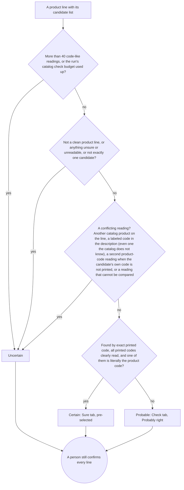

# Gate 4: The confidence tiers (certain, probable, uncertain)

[Back to the map](README.md) | Previous: [Gate 3](03-finding-the-product.md) | Next: [Gate 5, the review screen](05-the-review-screen.md)

## In one minute
After the lookup, every product line gets one of three tiers. The tier says how much the app trusts its own suggestion, and it decides which tab the line starts in:

- **Certain:** one product, found by its exact printed code, and nothing else on the line points to a different product. The line starts in **Sure**.
- **Probable:** one product, but found by something weaker (a spelling variant, an alias, a code inside the description). The line starts in **Check**, labelled "Probably right".
- **Uncertain:** anything else: several candidates, none, something unreadable, or a code on the line that conflicts (it does not have to be another catalog product; see the table below). The line starts in **Check**, labelled "Needs a look".

**A tier is not an approval.** Even a Certain line is only pre-selected; a person must still confirm it. This is a hard rule of the project (`AGENTS.md`; `decisions.md`, 2026-10-03).

## How a line gets its tier
The checks run in this order; the first that applies wins (`confidence_tier` in `backend/tiers.py`).

## The real conditions, in plain words
**Uncertain, if any one of these is true** (reason text in quotes is what the code stores):
1. The line carries more than 40 code-like readings (printed codes plus code-shaped words in the description): "Too many code-like readings to verify against the catalog".
2. The run needed more than 20,000 distinct codes checked against the catalog and this line's check was skipped: "Catalog check skipped because the lookup budget for this run was spent". A skipped check can never produce Certain.
3. The line is not labelled a product, or the model noted a doubt on it, or any printed code, the description, the quantity or the unit is marked unsure or unreadable or has alternative readings, or the lookup did not give exactly one candidate: "Unresolved source evidence, classification or candidate ambiguity".
4. Another reading on the line conflicts with the candidate: "Code-column and description readings conflict with the candidate". That includes a second code that is another catalog product, a labeled code in the description that the catalog does not know ("code ZZ-99"), a second product-code reading when the candidate's own code is not printed literally, and a reading that cannot be compared safely. See the next section.

**Certain, if none of the above holds and all of these are true:** the lookup method was "exact"; the line has at least one printed product code; every printed product code was clearly read ("observed"); and at least one of them is exactly (character for character) the candidate's code. Reason text: "Unique literal code-column match; explicit human approval still required".

**Probable:** everything else, for example a match by spelling variant (`acme 1001`), by alias, or by a code found in the description: "Description, embedded-code, alias or normalized match requires confirmation".

Only Certain lines get a pre-selected product (`suggested_candidate_id`); every line is saved with the approval status "needs approval" (`review_suggestions`).

## What counts as a disagreement, and what is harmless
These are the rules added by PR #19 (`_same_code`, `_split_hints`, `_split_codes`, `looks_like_measurement` in `backend/tiers.py`).

| Reading on the line | Treated as |
| --- | --- |
| The same code as the candidate, or the same after removing dashes, spaces and capitals | The same product: harmless |
| The candidate code with a letters-only supplier prefix in front, joined by a space, dash or slash (`ZED ACME-1001`), unless that whole reading is itself another catalog code | The same product: harmless |
| A size or spec: digits with a known unit, such as `50mm`, `250ML`, `12IN48IN10.5`, unless it is a catalog code | Set aside: harmless |
| A word in the description that is not any product code in our catalog | Set aside: harmless |
| A code in the description introduced by a label such as "code", "SKU", "product id" or "item code", that is not the candidate, not a size, and **not in the catalog either** (`code ZZ-99`) | **Conflict: Uncertain** (the app cannot tell what it names, so a label is enough to block Certain) |
| A second printed code that is in no catalog, when the line also prints the candidate's code literally | Set aside: harmless, noted ("N other reading(s) ignored") |
| A second printed code or description word that **is another active catalog product** | **Conflict: Uncertain** |
| A reading that cannot be compared safely, for example one with look-alike letters from other alphabets | **Conflict: Uncertain** (non-English letters are never silently converted) |
| A second reading in a product-code column (a column the model labelled vendor product code, SKU or vendor SKU) when the line does NOT print the candidate's code literally, for example an alias of the candidate written in such a column | **Conflict: Uncertain** |

Known risk, written down in `decisions.md` (2026-10-06): a second code that is a real product missing from our catalog no longer blocks Certain. The person still has to confirm.

## Worked example (invented)
Catalog: `ACME-1001` Brass hinge 50mm; `ACME-1002` Brass hinge 75mm; `ACME-2001` Steel bolt M8x40, box of 100. Supplier prefix: `ZED`.

| Line as printed | Tier | Why |
| --- | --- | --- |
| Code `ACME-1001`; description "Brass hinge 50mm" | Certain | Exact literal code; `50mm` is a size |
| Codes `ACME-1001` and `ZED ACME-1001` | Certain | The second is the same code with a supplier prefix |
| Codes `ACME-1001` and `CUST-77` (both labelled as product codes; `CUST-77` is not in the catalog) | Certain, with a note | `CUST-77` is set aside and counted in the note |
| Codes `ACME-1001` and `ACME-2001` | Uncertain | Two different catalog products on one line |
| Code `ACME-1001`; description "item code: ACME-2001" | Uncertain | A labelled code in the description is another product |
| Code `ACME-1001`; description "code ZZ-99" (`ZZ-99` is in no catalog) | Uncertain | A labelled code the app cannot place blocks Certain, even though it is not another catalog product |
| Code `acme 1001` | Probable | Found by spelling variant, not literal |
| Code `HNG-50`, an alias of ACME-1001 saved under the role "other" (as in [gate 3](03-finding-the-product.md)) | Probable | Alias match; the product code is not printed |
| Code `HNG-50` again, but the model labelled it a product code (role vendor product code, SKU or vendor SKU) and the alias is saved under that role | Uncertain | The same alias in a product-code column counts as a second product-code reading, and the candidate's own code is not printed |
| No code; description "Hinge, see item ACME-2001" | Probable | Found by a code in the description |
| Code `ACME-1001`; quantity read as "20" or "28" (unsure) | Uncertain | Part of the line is unsure |
| No code; "Brass hinge" fits two products | Uncertain | Two candidates |

## What a person sees
- Certain lines are in **Sure**; Probable and Uncertain lines are in **Check**, with the pill "Probably right" or "Needs a look". In this base the stored reason text is shown only inside the "Details" of the one-line view; the draft PR #21 (not in this base, still in review) adds a short explanation line on Check cards (see [gate 5](05-the-review-screen.md)).
- For an Uncertain line the server insists that the person first saves one of three answers (pick a product, add a new one, or "not a product") before approving; the three-tab screen does both steps with one click on **Confirm** (`confirmEntry` in `web/local-reader/workflow.js`). "No match" is refused for an Uncertain line.

## Where it lives
- [`backend/tiers.py`](https://github.com/CarlitosRed/advance-po-reader/blob/742666345a97dd00c1ed0d9e1ab725618bed3110/backend/tiers.py): `confidence_tier`, `_same_code`, `_split_hints`, `_split_codes`, `looks_like_measurement`, `review_suggestions`, `ignored_hint_evidence` (records what was set aside, without copying printed text).
- Limits as constants: `MAX_READINGS_PER_ROW = 40`, `MAX_LOOKUP_KEYS_PER_RUN = 20000`, `LOOKUP_BATCH = 1000`.
- The server refuses an approval that skips the rules: `review_run` in [`backend/service.py`](https://github.com/CarlitosRed/advance-po-reader/blob/742666345a97dd00c1ed0d9e1ab725618bed3110/backend/service.py).

## Built by PR
[#7](https://github.com/CarlitosRed/advance-po-reader/pull/7) (the tiers: certain, probable, uncertain, and the rule that a person always approves); [#19](https://github.com/CarlitosRed/advance-po-reader/pull/19) (supplier prefix, sizes, second codes, bounded lookup, skipped check never Certain).

## How we know it works
- Tests: `tests/backend/test_catalog_database.py` and `tests/backend/test_identifier_roles.py` (run against a real PostgreSQL database), `tests/goal/test_goal_tiers.py`. The builder reported 371 backend tests passed on PostgreSQL for #19's last commit (`decisions.md`; not re-run for this page).
- Reviews: Codex reviewed #19 three times. Findings fixed: a supplier prefix hid a real second product; look-alike letters compared equal; an unbounded lookup crashed on 330 rows; a skipped check relaxed the rules. Approved at `9cc9aca`.
- Measured on the 33 sample orders (`decisions.md`, 2026-10-06, stored runs, no spend): of the 150 product lines, **120 were Certain, 13 Probable and 17 Uncertain**; two more lines were labelled unknown and are also Uncertain (19 Uncertain in all; the 17 is derived from the logged totals). An earlier version of PR #19 (before its second-code rule) measured 95 Certain on the same orders. The 19 Uncertain were: 13 with two to four candidates found only by text similarity, 2 with no candidate, 2 unknown lines, 2 still in conflict.
- Caveats: the catalog was built from these same orders. "Certain" is how sure the app is, not a measured accuracy; no human audited every Certain line.

## Status
In version 1.
