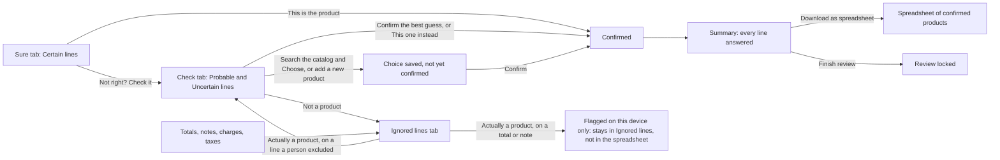

# Gate 5: The review screen (Sure, Check, Ignored lines, snapshots)

[Back to the map](README.md) | Previous: [Gate 4](04-confidence-tiers.md) | Next: [Gate 6, decisions and saved data](06-decisions-and-saved-data.md)

## In one minute
After a reading is accepted, the person sees **one page with three tabs**. Each line of the order sits on a card with a **snapshot**: a cropped picture of the original page with that line outlined, so the person can compare what was printed with what the app suggests.

- **Sure** (green): lines where the tier is Certain. One product is suggested ("Looks like ..."). The person looks at the picture and presses the green check-mark button **This is the product**. There is also **Confirm all visible**.
- **Check** (amber): everything the app is not sure about. Each card starts with **one short sentence saying why** (see "The reason sentence" below), then the best guess, up to two others under "Could also be", a catalog search, "add a new product", and "not a product".
- **Ignored lines** (gray, last, optional): totals, notes, charges, taxes, and lines a person marked "not a product". A place to glance. The person never has to open it: nothing in it counts as work, and Finish does not wait for it ([`assignTabs`, lines 48-49](https://github.com/CarlitosRed/advance-po-reader/blob/a76aa4a866e2929cb3cead1109b1b9391b3e9279/web/local-reader/workflow.js#L48-L49)).

Nothing is final until a person presses a confirm button, and nothing here changes what was printed.

## What the screen shows in version 1
This page describes `integration/ui-and-matching` at `a76aa4a`, which contains PR [#21](https://github.com/CarlitosRed/advance-po-reader/pull/21) (merged as `a9c6fe3`, approved by Codex at `51e79cc`). Links to `workflow.js`, `app.js` and the demo scripts point at that commit; the one link to `backend/app.py` points at the earlier commit `7426663`, where that file has the same content.

| | Version 1 |
| --- | --- |
| Third tab | "Ignored lines": optional, shown quietly with the word "optional" (or "none" when empty) instead of a count of lines to do. Its lines are never "to do" and never required to reach the Summary or Finish ([lines 48-49](https://github.com/CarlitosRed/advance-po-reader/blob/a76aa4a866e2929cb3cead1109b1b9391b3e9279/web/local-reader/workflow.js#L48-L49), [67](https://github.com/CarlitosRed/advance-po-reader/blob/a76aa4a866e2929cb3cead1109b1b9391b3e9279/web/local-reader/workflow.js#L67), [755](https://github.com/CarlitosRed/advance-po-reader/blob/a76aa4a866e2929cb3cead1109b1b9391b3e9279/web/local-reader/workflow.js#L755)) |
| Sure card | "Looks like [product]" and a green check-mark button "This is the product" ([lines 650-653](https://github.com/CarlitosRed/advance-po-reader/blob/a76aa4a866e2929cb3cead1109b1b9391b3e9279/web/local-reader/workflow.js#L650-L653), [701](https://github.com/CarlitosRed/advance-po-reader/blob/a76aa4a866e2929cb3cead1109b1b9391b3e9279/web/local-reader/workflow.js#L701)) |
| Check card | One reason sentence, then the best guess with a **Confirm** button, then "Could also be:" with up to two more products, each with a button "This one instead". That button approves at once, exactly like Confirm ([lines 698-712](https://github.com/CarlitosRed/advance-po-reader/blob/a76aa4a866e2929cb3cead1109b1b9391b3e9279/web/local-reader/workflow.js#L698-L712), [850-853](https://github.com/CarlitosRed/advance-po-reader/blob/a76aa4a866e2929cb3cead1109b1b9391b3e9279/web/local-reader/workflow.js#L850-L853)) |
| Check intro text | "Each line says why we are not sure. Confirm the best guess, pick another product, or mark the line as not a product." ([line 527](https://github.com/CarlitosRed/advance-po-reader/blob/a76aa4a866e2929cb3cead1109b1b9391b3e9279/web/local-reader/workflow.js#L527)) |
| "Not a product" | Moves the line to Ignored lines and says "Moved to Ignored lines." ([lines 894-902](https://github.com/CarlitosRed/advance-po-reader/blob/a76aa4a866e2929cb3cead1109b1b9391b3e9279/web/local-reader/workflow.js#L894-L902)) |

## The reason sentence on Check cards
**What the person sees.** A short sentence at the top of a Check card, for example "The match comes from a code in the description; please check it." or "3 catalog products could match this line; pick the right one." (invented wording of the same kind as the real ones; the real list has 24 rows and is not copied here).

**How it is chosen** ([`REASON_RULES`, lines 177-216](https://github.com/CarlitosRed/advance-po-reader/blob/a76aa4a866e2929cb3cead1109b1b9391b3e9279/web/local-reader/workflow.js#L177-L216); [`plainReasonRule`, lines 217-221](https://github.com/CarlitosRed/advance-po-reader/blob/a76aa4a866e2929cb3cead1109b1b9391b3e9279/web/local-reader/workflow.js#L217-L221)):
1. The screen collects a few facts the server already gave for the line: how many candidate products there are, how the candidates were found (the `method`), the server's own reason and tier-reason texts, whether a code was printed, which fields were marked unclear, and whether a note came with the reading ([`reasonFacts`, lines 150-174](https://github.com/CarlitosRed/advance-po-reader/blob/a76aa4a866e2929cb3cead1109b1b9391b3e9279/web/local-reader/workflow.js#L150-L174)).
2. The 24 rows are tried **in order**. The first row whose condition is true gives the sentence; later rows are not looked at. The order is the priority.
3. The last row (`check`) is always true. If nothing earlier is proven, the line gets the neutral sentence "Please check this match against the line."

**Where it is shown, and where not.** On Check cards only. It is left out when the person has already saved a choice on the card (the label then says "Your choice · please confirm"), and on a card that is already Confirmed ([lines 689-694](https://github.com/CarlitosRed/advance-po-reader/blob/a76aa4a866e2929cb3cead1109b1b9391b3e9279/web/local-reader/workflow.js#L689-L694) and [706](https://github.com/CarlitosRed/advance-po-reader/blob/a76aa4a866e2929cb3cead1109b1b9391b3e9279/web/local-reader/workflow.js#L706)). Sure cards and Ignored lines have no reason sentence. The one-line view still shows its own stored reason text inside "Details" (unchanged).

**Examples (invented).** Each sentence is shown only when no row above it in the list is true for the line.

| What the data shows (invented line) | Sentence kind |
| --- | --- |
| Two candidates, `ACME-D100` and `D100` | Names both products ([row `look_alikes_twin`, lines 178-179](https://github.com/CarlitosRed/advance-po-reader/blob/a76aa4a866e2929cb3cead1109b1b9391b3e9279/web/local-reader/workflow.js#L178-L179)) |
| Three candidates, no such pair | "3 catalog products could match this line; pick the right one." ([line 180](https://github.com/CarlitosRed/advance-po-reader/blob/a76aa4a866e2929cb3cead1109b1b9391b3e9279/web/local-reader/workflow.js#L180)) |
| No candidate, and the server says the search ran and found nothing | "The catalog search found no product for this line." ([lines 187-188](https://github.com/CarlitosRed/advance-po-reader/blob/a76aa4a866e2929cb3cead1109b1b9391b3e9279/web/local-reader/workflow.js#L187-L188)) |
| Method is a code found in the description, and a code was printed | "Matched from a code in the description; please check it against the printed line." ([lines 197-198](https://github.com/CarlitosRed/advance-po-reader/blob/a76aa4a866e2929cb3cead1109b1b9391b3e9279/web/local-reader/workflow.js#L197-L198)) |
| Nothing above is proven, tier is not Certain | "The app is not sure enough to confirm this one by itself." ([line 214](https://github.com/CarlitosRed/advance-po-reader/blob/a76aa4a866e2929cb3cead1109b1b9391b3e9279/web/local-reader/workflow.js#L214)) |

**What is NOT claimed.**
- The sentence shows only the first proven fact. A line with two candidates and also conflicting readings shows the look-alike sentence; the conflict is not shown ([rows in order, lines 178-192](https://github.com/CarlitosRed/advance-po-reader/blob/a76aa4a866e2929cb3cead1109b1b9391b3e9279/web/local-reader/workflow.js#L178-L192)).
- The cause of a conflict is not shown. The row `conflict` only says "The app found conflicting readings on this line; please check it." It does not say which readings, or which product they conflict with ([line 192](https://github.com/CarlitosRed/advance-po-reader/blob/a76aa4a866e2929cb3cead1109b1b9391b3e9279/web/local-reader/workflow.js#L192)).
- Which search produced an approximate match is not shown. The approximate-match rows say "an approximate search on the name or code" or "on the description" and nothing more ([lines 205-208](https://github.com/CarlitosRed/advance-po-reader/blob/a76aa4a866e2929cb3cead1109b1b9391b3e9279/web/local-reader/workflow.js#L205-L208)).
- Whether the document has a code column is not shown. "No code was read under “Label”" appears only when a blank code cell with a printed label was read, and it names that label only ([lines 199-200](https://github.com/CarlitosRed/advance-po-reader/blob/a76aa4a866e2929cb3cead1109b1b9391b3e9279/web/local-reader/workflow.js#L199-L200), [`blankCodeLabels`, lines 128-132](https://github.com/CarlitosRed/advance-po-reader/blob/a76aa4a866e2929cb3cead1109b1b9391b3e9279/web/local-reader/workflow.js#L128-L132)).
- The sentences do not say that a printed code is close to, or different from, a product, and no row says that a column is missing. One row does state a verified fact of the search: `exact` says "A printed code matched exactly; please check the match against the line." (it needs the exact search method and a printed code, [lines 212-213](https://github.com/CarlitosRed/advance-po-reader/blob/a76aa4a866e2929cb3cead1109b1b9391b3e9279/web/local-reader/workflow.js#L212-L213)); it can appear on a Check card, for example after a person pressed "Not right? Check it" on a Sure card ([lines 56](https://github.com/CarlitosRed/advance-po-reader/blob/a76aa4a866e2929cb3cead1109b1b9391b3e9279/web/local-reader/workflow.js#L56), [706](https://github.com/CarlitosRed/advance-po-reader/blob/a76aa4a866e2929cb3cead1109b1b9391b3e9279/web/local-reader/workflow.js#L706), [882](https://github.com/CarlitosRed/advance-po-reader/blob/a76aa4a866e2929cb3cead1109b1b9391b3e9279/web/local-reader/workflow.js#L882)). The other sentences say what was searched or found, and ask the person to look ([comment, lines 90-98](https://github.com/CarlitosRed/advance-po-reader/blob/a76aa4a866e2929cb3cead1109b1b9391b3e9279/web/local-reader/workflow.js#L90-L98)).
- A sentence does not mean the match is wrong or right. A person still decides every line.

**One dependency to know.** Six facts (search not run, search failed, search finished empty, too many readings, lookup budget, conflict) are recognised by matching the server's own message wording (for example a search "that finished empty" is recognised by the exact text "No candidate found in the supplied tenant/vendor catalog"). If the server's wording changes, that one fact can no longer be proven, so the rows that need it do not apply. Another supported row may still win: for example, if the conflict message were paraphrased, a line with a code found in the description would show the "Matched from a code in the description" sentence instead of the conflict sentence. The neutral sentence appears only when no earlier row is true ([lines 99-101](https://github.com/CarlitosRed/advance-po-reader/blob/a76aa4a866e2929cb3cead1109b1b9391b3e9279/web/local-reader/workflow.js#L99-L101), [161-165](https://github.com/CarlitosRed/advance-po-reader/blob/a76aa4a866e2929cb3cead1109b1b9391b3e9279/web/local-reader/workflow.js#L161-L165)).

**Where conditions are exact and where they are lists.** Two rows use a short list of method names (`description_code_hint` and `description_numeric_code_hint`, [line 175](https://github.com/CarlitosRed/advance-po-reader/blob/a76aa4a866e2929cb3cead1109b1b9391b3e9279/web/local-reader/workflow.js#L175)); one fact uses a list of two evidence kinds (`description_hint_ignored`, `code_reading_ignored`, [line 171](https://github.com/CarlitosRed/advance-po-reader/blob/a76aa4a866e2929cb3cead1109b1b9391b3e9279/web/local-reader/workflow.js#L171)). The other method rows compare with one exact name (`trigram`, `normalized`, `exact`, `description_code_hint_trigram`). The tests that check this table are `tests/goal/reasons.cjs` (table) and `tests/goal/reasons-generated.cjs` (all combinations); not re-run for this page.

## How the tabs connect

Four things the picture separates:
- **Two different paths to Confirmed.** (a) A product already shown on the card has its own button: **This is the product** on a Sure card, **Confirm** on the best guess of a Check card, **This one instead** on each product under "Could also be" ([lines 701](https://github.com/CarlitosRed/advance-po-reader/blob/a76aa4a866e2929cb3cead1109b1b9391b3e9279/web/local-reader/workflow.js#L701), [708](https://github.com/CarlitosRed/advance-po-reader/blob/a76aa4a866e2929cb3cead1109b1b9391b3e9279/web/local-reader/workflow.js#L708), [711](https://github.com/CarlitosRed/advance-po-reader/blob/a76aa4a866e2929cb3cead1109b1b9391b3e9279/web/local-reader/workflow.js#L711)). One press approves it and saves the approval at once (`confirmEntry`, [lines 850-853](https://github.com/CarlitosRed/advance-po-reader/blob/a76aa4a866e2929cb3cead1109b1b9391b3e9279/web/local-reader/workflow.js#L850-L853)). On a line the app called Uncertain, that same press first saves the choice and then the approval, as two saved events. (b) A product found with the catalog search ("Choose") or a new product ("Add new product") saves only a choice: the card then says "Your choice · please confirm", and only a press on **Confirm** makes the line Confirmed ([lines 905-912](https://github.com/CarlitosRed/advance-po-reader/blob/a76aa4a866e2929cb3cead1109b1b9391b3e9279/web/local-reader/workflow.js#L905-L912), [929-935](https://github.com/CarlitosRed/advance-po-reader/blob/a76aa4a866e2929cb3cead1109b1b9391b3e9279/web/local-reader/workflow.js#L929-L935), [705](https://github.com/CarlitosRed/advance-po-reader/blob/a76aa4a866e2929cb3cead1109b1b9391b3e9279/web/local-reader/workflow.js#L705)). So searching or adding is a two-step path; confirming something already shown is not.
- **Reopening a line a person excluded** ("Actually a product" on a line marked not a product) moves it back to Check with the catalog search open. The exclusion stays on record until a product is chosen, and then it still needs Confirm.
- **Totals, notes, charges and taxes cannot be reopened.** "Actually a product" on one of them only sets a flag on this device. The line stays in Ignored lines, the server is not told, and it never reaches the spreadsheet.
- The spreadsheet and Finish are two separate buttons on the Summary. The download does not wait for Finish ([gate 6](06-decisions-and-saved-data.md)).

## Worked example (invented)
Order `PO-TEST-003` with seven printed lines:

| Printed | Tier | Starts in | Reason sentence (kind) | What the person does |
| --- | --- | --- | --- | --- |
| `ACME-1001  Brass hinge 50mm  20` | Certain | Sure | none (Sure cards have none) | Looks at the snapshot, presses **This is the product** |
| `ACME-1002  Brass hinge 75mm  10` | Certain | Sure | none | Confirms (or uses Confirm all visible) |
| `acme 2001  Steel bolt box  4` | Probable | Check, "Probably right" | one of the "matched ..." sentences, or the neutral one | Presses **Confirm** on the guess ACME-2001 |
| `Brass hinge  8` (no code, fits two products) | Uncertain | Check, "Needs a look" | "2 catalog products could match this line; pick the right one." | Presses **This one instead** on ACME-1001 (or searches the catalog, then presses Confirm) |
| `XYZ-0000 Mystery part  2` (nothing matches) | Uncertain | Check, no suggestion | "The catalog search found no product for this line." | Searches, or adds a new product, or says not a product |
| `Freight charge  12.00` | not labelled a product | Ignored lines | none | Nothing needed |
| `Subtotal  250.00` | not labelled a product | Ignored lines | none | Nothing needed |

The progress bar says "N lines left to check" and counts only the five product lines ([lines 749-751](https://github.com/CarlitosRed/advance-po-reader/blob/a76aa4a866e2929cb3cead1109b1b9391b3e9279/web/local-reader/workflow.js#L749-L751)).

**State ledger for the same order (invented).** The tab labels show a count of lines to do for Sure and Check, and the word "optional" for Ignored lines ([line 755](https://github.com/CarlitosRed/advance-po-reader/blob/a76aa4a866e2929cb3cead1109b1b9391b3e9279/web/local-reader/workflow.js#L755)).

| Step | Sure tab | Check tab | Ignored lines tab | Summary and Finish |
| --- | --- | --- | --- | --- |
| Start | 2 to confirm | 3 to check | 2, optional | The Summary lists 5 lines still to answer; Finish is disabled |
| Both Sure lines confirmed | all done | 3 to check | 2, optional | 3 lines left |
| `acme 2001` confirmed | all done | 2 to check | 2, optional | 2 left |
| `Brass hinge` confirmed through "This one instead" | all done | 1 to check | 2, optional | 1 left |
| `Mystery part`: **Not a product** | all done | all done (the line moved out) | 3, optional | "Every line has an answer"; Finish is enabled unless a partly read page, an unacknowledged warning or a failed page blocks it ([lines 427-432](https://github.com/CarlitosRed/advance-po-reader/blob/a76aa4a866e2929cb3cead1109b1b9391b3e9279/web/local-reader/workflow.js#L427-L432)) |

In this walk the person finished without ever opening the Ignored lines tab. That holds because lines placed there count as done from the start (document lines: [line 49](https://github.com/CarlitosRed/advance-po-reader/blob/a76aa4a866e2929cb3cead1109b1b9391b3e9279/web/local-reader/workflow.js#L49); lines a person excluded: [line 60](https://github.com/CarlitosRed/advance-po-reader/blob/a76aa4a866e2929cb3cead1109b1b9391b3e9279/web/local-reader/workflow.js#L60)) and the list of lines still to answer comes from the server ([line 392](https://github.com/CarlitosRed/advance-po-reader/blob/a76aa4a866e2929cb3cead1109b1b9391b3e9279/web/local-reader/workflow.js#L392)). The exception: if the person presses "Actually a product" on the excluded `Mystery part`, it returns to Check and counts as work again ([line 56](https://github.com/CarlitosRed/advance-po-reader/blob/a76aa4a866e2929cb3cead1109b1b9391b3e9279/web/local-reader/workflow.js#L56), [883](https://github.com/CarlitosRed/advance-po-reader/blob/a76aa4a866e2929cb3cead1109b1b9391b3e9279/web/local-reader/workflow.js#L883)).

## Snapshots
- The picture of a page is fetched and kept while the page is open (up to 12 pages; the oldest is dropped, and fetched again if needed, [`pageImage`, lines 531 and 551-565](https://github.com/CarlitosRed/advance-po-reader/blob/a76aa4a866e2929cb3cead1109b1b9391b3e9279/web/local-reader/workflow.js#L551-L565)); every line on that page is cropped from the same picture, with the line outlined in the tab's colour and the rest softened (`drawSnapshot`, `snapshotGeometry`).
- **Enlarge** opens a dialog with two views: "This line" and "Whole page N".
- If a line has no exact spot on the page, its snapshot shows the whole page and a banner says how many lines on which page are like that.
- If a page picture cannot load, the cards on that page say "No picture for this line. Use the printed text below." with **Try again**, and a banner names the pages.
- Swipe sideways to see the whole width of the line on a phone.

## What a person sees and can do on one card
- Title, for example "Line 3 · ACME-2001", and a status pill (Sure, Probably right, Needs a look, Confirmed, Marked not a product).
- Printed facts: code, description (continuation lines appended), quantity in the standard format with a "Check" flag when it could not be standardized ([gate 6](06-decisions-and-saved-data.md)), price.
- Buttons: This is the product (Sure) or Confirm and This one instead (Check); Change product (opens the search panel); Not a product; Not right? Check it (in Sure); Enlarge; Open line (the one-line-at-a-time view).
- A filter box and a To do / All switch per tab. A reviewer name is asked once ("Who is reviewing?") and saved on the device.
- When every line has an answer, the page offers the **Summary**. From there the person can download the spreadsheet at any time, and, as a separate step, press Finish (when nothing blocks it).

## Honest limits
- "Not right? Check it" and, on a totals/notes line, "Agree, not a product" and "Actually a product" are remembered **only on this device** (`localStorage`), not on the server; they do not reach the spreadsheet ([`handleTabAction`, lines 878-883](https://github.com/CarlitosRed/advance-po-reader/blob/a76aa4a866e2929cb3cead1109b1b9391b3e9279/web/local-reader/workflow.js#L878-L883); the marks are kept in the browser's `localStorage`, [lines 533-549](https://github.com/CarlitosRed/advance-po-reader/blob/a76aa4a866e2929cb3cead1109b1b9391b3e9279/web/local-reader/workflow.js#L533-L549)). "Actually a product" on a line a person excluded is different: it only reopens the choice, and the choice and the Confirm are saved on the server.
- A Sure line is a suggestion. "Sure" means "the printed code matched exactly one product and nothing contradicted it"; it does not mean the app is never wrong.
- The Safety Net's independent page counts and text checks are **not** part of this screen in version 1 ([gate 7](07-safety-net.md)).

## Where it lives
- [`web/local-reader/workflow.js`](https://github.com/CarlitosRed/advance-po-reader/blob/a76aa4a866e2929cb3cead1109b1b9391b3e9279/web/local-reader/workflow.js) at `a76aa4a`: `assignTabs` (which tab), `tabCounts`, `defaultTabOf`, `emptyTabCopy` (what an empty tab says), `reasonFacts`, `REASON_RULES`, `plainReasonRule` (the reason sentence), `snapshotGeometry`, `renderTabs`, `cardParts`, `confirmEntry`, `bulkConfirm`.
- [`web/local-reader/app.js`](https://github.com/CarlitosRed/advance-po-reader/blob/a76aa4a866e2929cb3cead1109b1b9391b3e9279/web/local-reader/app.js): the shell, reviewer gate, one-line view, quantity display.
- [`scripts/poc-demo-ui.js`](https://github.com/CarlitosRed/advance-po-reader/blob/a76aa4a866e2929cb3cead1109b1b9391b3e9279/scripts/poc-demo-ui.js) and [`scripts/poc-demo.py`](https://github.com/CarlitosRed/advance-po-reader/blob/a76aa4a866e2929cb3cead1109b1b9391b3e9279/scripts/poc-demo.py): the demo wrapper (order list, upload page, sample orders).
- Server side: `GET /runs/{id}/suggestions` (candidates and tiers) in [`backend/app.py`](https://github.com/CarlitosRed/advance-po-reader/blob/742666345a97dd00c1ed0d9e1ab725618bed3110/backend/app.py).

## Built by PR
[#16](https://github.com/CarlitosRed/advance-po-reader/pull/16) (three tabs and snapshots); [#13](https://github.com/CarlitosRed/advance-po-reader/pull/13) (phone-friendly cards, order list, done screen); [#21](https://github.com/CarlitosRed/advance-po-reader/pull/21) (plain reasons, check-mark, Ignored lines; approved by Codex at `51e79cc`, merged as `a9c6fe3`).

## How we know it works
- Tests: `tests/goal/test_goal_tabs.py` (node check of tab assignment and crop geometry), `tests/goal/test_goal_tabs_data.py` (tabs fed by the real routes), `tests/goal/test_goal_tabs_dom.py` (a real browser opens empty tabs without error), `tests/goal/test_goal_review_controls.py`, `tests/backend/test_poc_demo_tabs.py`, and `scripts/verify-poc-demo.cjs` (browser walk-through of the demo). The real-browser tests are skipped in CI where no browser is installed (the CI file says so); not re-run for this page.
- Reviews: #16 was "Not approved" at `1cac21c` (a crash when opening an empty tab; an out-of-date verifier) and Approved at `906dbef` after both were fixed. #13 Approved at `9b69c4e`.
- Measured on the 33 sample orders (`decisions.md`, derived from the tier counts): of 150 product lines, 120 start in Sure and 30 in Check; two more unknown lines start in Check. Notes, totals, charges and taxes (about 155 lines) are placed in the Ignored lines tab, not in Sure or Check (`assignTabs`, lines 43-49). No usability study has been done.

## Status
In version 1: tabs, snapshots, Confirm, the reason sentence on Check cards, the check-mark on Sure cards and the optional Ignored lines tab (checked against `integration/ui-and-matching` at `a76aa4a`).
