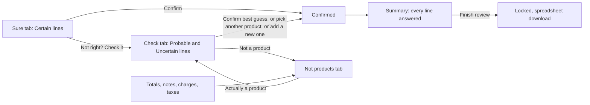

# Gate 5: The review screen (Sure, Check, Ignored lines, snapshots)

[Back to the map](README.md) | Previous: [Gate 4](04-confidence-tiers.md) | Next: [Gate 6, decisions and saved data](06-decisions-and-saved-data.md)

## In one minute
After a reading is accepted, the person sees **one page with three tabs**. Each line of the order sits on a card with a **snapshot**: a cropped picture of the original page with that line outlined, so the person can compare what was printed with what the app suggests.

- **Sure** (green): lines where the tier is Certain. One product is suggested. The person looks at the picture and confirms. There is also **Confirm all visible**.
- **Check** (amber): everything the app is not sure about. The best guess, up to two other candidates, a catalog search, "add a new product", and "not a product".
- **Not products** (gray, last): totals, notes, charges, taxes, and lines a person marked "not a product". Mostly a place to glance; see the next section for what changes in PR #21.

Nothing is final until a person presses a confirm button, and nothing here changes what was printed.

## What is in this version and what is coming in PR #21
This page was written against the base `integration/ui-and-matching` at `7426663`. **PR #21 is not in that base.** It is a draft with its own review still open (its head at the time of writing is `aee4c16`; its last recorded signed review on GitHub is "Not approved" at `ebbb904`, an earlier commit; a re-review of the newer head is pending). Version 1 is planned to include it once its last review passes.

| | In this base (PR #16) | Coming in PR #21 |
| --- | --- | --- |
| Third tab name | "Not products", listed as "to review" on the tab (it does not block Finish, because the server asks for no answer on totals and notes) | "Ignored lines": optional, shown quietly, **never required** to reach the summary or Finish |
| Sure card | Label "Matches the printed code" and a **Confirm** button | "Looks like [product]" with a green check-mark button "This is the product" |
| Check card | Best guess and up to two more, no explanation | **One plain sentence** saying why the app is not sure, then the best guess, then "Could also be" with a button "This one instead" |
| Check intro text | "Likely or unclear matches..." | "Each line says why we are not sure..." |

The sentences in PR #21 (from `plainReason` in its `web/local-reader/workflow.js`; they may still change before merge) include, for example: "The catalog has both 'X' and 'Y'." ; "No catalog product matches this code or name." ; "Two different product codes are printed on this line." ; "Part of this line is hard to read." ; "The printed code is written a little differently from the catalog code." ; "No code column on this line; the code was found inside the description." ; "No product code on this line; matched by name only." ; "This line has too many codes to check against the catalog." ; and a safe fallback, "The app is not sure enough to confirm this one by itself." Each is chosen from facts the server already returned (candidates, method, tier reason, printed codes), with the first matching case winning.

## How the tabs connect

## Worked example (invented)
Order `PO-TEST-003` with seven printed lines:

| Printed | Tier | Starts in | What the person does |
| --- | --- | --- | --- |
| `ACME-1001  Brass hinge 50mm  20` | Certain | Sure | Looks at the snapshot, presses Confirm |
| `ACME-1002  Brass hinge 75mm  10` | Certain | Sure | Confirms (or uses Confirm all visible) |
| `acme 2001  Steel bolt box  4` | Probable | Check, "Probably right" | Confirms the guess ACME-2001 |
| `Brass hinge  8` (no code, fits two products) | Uncertain | Check, "Needs a look" | Picks ACME-1001 from the list, or searches the catalog |
| `XYZ-0000 Mystery part  2` (nothing matches) | Uncertain | Check, no suggestion | Searches, or adds a new product, or says not a product |
| `Freight charge  12.00` | not labelled a product | Not products | Nothing needed |
| `Subtotal  250.00` | not labelled a product | Not products | Nothing needed |

The progress bar says "N lines left to check" and counts only the five product lines.

## Snapshots
- The picture of a page is fetched once and kept; every line on that page is cropped from the same picture, with the line outlined in the tab's colour and the rest softened (`drawSnapshot`, `snapshotGeometry`).
- **Enlarge** opens a dialog with two views: "This line" and "Whole page N".
- If a line has no exact spot on the page, its snapshot shows the whole page and a banner says how many lines on which page are like that.
- If a page picture cannot load, the cards on that page say "No picture for this line. Use the printed text below." with **Try again**, and a banner names the pages.
- Swipe sideways to see the whole width of the line on a phone.

## What a person sees and can do on one card
- Title, for example "Line 3 · ACME-2001", and a status pill (Sure, Probably right, Needs a look, Confirmed, Marked not a product).
- Printed facts: code, description (continuation lines appended), quantity in the standard format with a "Check" flag when it could not be standardized ([gate 6](06-decisions-and-saved-data.md)), price.
- Buttons: Confirm; Change product (opens the search panel); Not a product; Not right? Check it (in Sure); Enlarge; Open line (the one-line-at-a-time view).
- A filter box and a To do / All switch per tab. A reviewer name is asked once ("Who is reviewing?") and saved on the device.
- When every line has an answer, the page offers the **Summary**, and from there Finish and the spreadsheet.

## Honest limits
- "Not right? Check it", "Agree, not a product" and "Actually a product" on a totals/notes line are remembered **only on this device** (`localStorage`), not on the server; they do not reach the spreadsheet (`workflow.js`, `toggleMark`).
- A Sure line is a suggestion. "Sure" means "the printed code matched exactly one product and nothing contradicted it"; it does not mean the app is never wrong.
- The Safety Net's independent page counts and text checks are **not** part of this screen in version 1 ([gate 7](07-safety-net.md)).

## Where it lives
- `web/local-reader/workflow.js`: `assignTabs` (which tab), `tabCounts`, `defaultTabOf`, `emptyTabCopy` (what an empty tab says), `snapshotGeometry`, `renderTabs`, `cardParts`, `confirmEntry`, `bulkConfirm`.
- `web/local-reader/app.js`: the shell, reviewer gate, one-line view, quantity display.
- `scripts/poc-demo-ui.js` and `scripts/poc-demo.py`: the demo wrapper (order list, upload page, sample orders).
- Server side: `GET /runs/{id}/suggestions` (candidates and tiers) in `backend/app.py`.

## Built by PR
[#16](https://github.com/CarlitosRed/advance-po-reader/pull/16) (three tabs and snapshots); [#13](https://github.com/CarlitosRed/advance-po-reader/pull/13) (phone-friendly cards, order list, done screen); [#21](https://github.com/CarlitosRed/advance-po-reader/pull/21) (plain reasons, check-mark, Ignored lines: coming, not in this base).

## How we know it works
- Tests: `tests/goal/test_goal_tabs.py` (node check of tab assignment and crop geometry), `tests/goal/test_goal_tabs_data.py` (tabs fed by the real routes), `tests/goal/test_goal_tabs_dom.py` (a real browser opens empty tabs without error), `tests/goal/test_goal_review_controls.py`, `tests/backend/test_poc_demo_tabs.py`, and `scripts/verify-poc-demo.cjs` (browser walk-through of the demo). The real-browser tests are skipped in CI where no browser is installed (the CI file says so); not re-run for this page.
- Reviews: #16 was "Not approved" at `1cac21c` (a crash when opening an empty tab; an out-of-date verifier) and Approved at `906dbef` after both were fixed. #13 Approved at `9b69c4e`.
- Measured on the 33 sample orders (`decisions.md`, derived from the tier counts): of 150 product lines, 120 start in Sure and 30 in Check; two more unknown lines start in Check. Notes, totals, charges and taxes (about 155 lines) appear only in the Not products tab. No usability study has been done.

## Status
Tabs, snapshots and Confirm: in version 1. Plain reasons, check-mark and Ignored lines: coming in PR #21 (in version 1 scope, not in this base).
