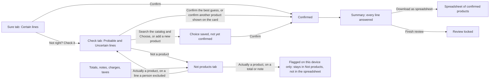

# Gate 5: The review screen (Sure, Check, Ignored lines, snapshots)

[Back to the map](README.md) | Previous: [Gate 4](04-confidence-tiers.md) | Next: [Gate 6, decisions and saved data](06-decisions-and-saved-data.md)

## In one minute
After a reading is accepted, the person sees **one page with three tabs**. Each line of the order sits on a card with a **snapshot**: a cropped picture of the original page with that line outlined, so the person can compare what was printed with what the app suggests.

- **Sure** (green): lines where the tier is Certain. One product is suggested. The person looks at the picture and confirms. There is also **Confirm all visible**.
- **Check** (amber): everything the app is not sure about. The best guess, up to two other candidates, a catalog search, "add a new product", and "not a product".
- **Not products** (gray, last): totals, notes, charges, taxes, and lines a person marked "not a product". Mostly a place to glance; see the next section for what changes in PR #21.

Nothing is final until a person presses a confirm button, and nothing here changes what was printed.

## What is in this version and what is coming in PR #21
This page was written against the base `integration/ui-and-matching` at `7426663`. **PR #21 is not in that base.** It is a draft with its own review still open. The "coming" column below describes its commit `e1088a0`, a dated snapshot: the PR's head has moved since (a later commit, `9d17c10`, existed when this page was last reviewed), and this page does not describe that newer head. Version 1 is planned to include it once its review passes. I read the diff of `e1088a0` against this base for the rows below, so treat the "coming" column as possibly out of date.

| | In this base (PR #16) | Coming in PR #21 |
| --- | --- | --- |
| Third tab name | "Not products", listed as "to review" on the tab (it does not block Finish, because the server asks for no answer on totals and notes) | "Ignored lines": optional, shown quietly, **never required** to reach the summary or Finish |
| Sure card | Label "Matches the printed code" and a **Confirm** button | "Looks like [product]" with a green check-mark button "This is the product" |
| Check card | Best guess and up to two more, each with its own confirm button ("Confirm this one" when there are several); no explanation | A short explanation line (not described here), then the best guess, then "Could also be" with a button "This one instead", which approves at once like the base's confirm button does ([`e1088a0` lines 635-637](https://github.com/CarlitosRed/advance-po-reader/blob/e1088a04a37a31962469c5ac37e07cdef36bc2ad/web/local-reader/workflow.js#L635-L637), [810-812](https://github.com/CarlitosRed/advance-po-reader/blob/e1088a04a37a31962469c5ac37e07cdef36bc2ad/web/local-reader/workflow.js#L810-L812)) |
| Check intro text | "Likely or unclear matches..." | "Each line says why we are not sure..." |

About the explanation line: PR #21 adds a short plain-language line to Check cards saying why the app is not sure. Its wording is still being reviewed, so **this page does not describe or quote it**.

## How the tabs connect

Four things the picture separates:
- **Two different paths to Confirmed.** (a) A product already shown on the card, the best guess or one of the other candidates under it, has its own confirm button ("Confirm this one" when there are several). One press approves it and saves the approval at once ([`workflow.js` lines 554-555](https://github.com/CarlitosRed/advance-po-reader/blob/742666345a97dd00c1ed0d9e1ab725618bed3110/web/local-reader/workflow.js#L554-L555), `confirmEntry` [lines 692-694](https://github.com/CarlitosRed/advance-po-reader/blob/742666345a97dd00c1ed0d9e1ab725618bed3110/web/local-reader/workflow.js#L692-L694)). On a line the app called Uncertain, that same press first saves the choice and then the approval, as two saved events. (b) A product found with the catalog search ("Choose") or a new product ("Add new product") saves only a choice: the card then says "Your choice · please confirm", and only a press on **Confirm** makes the line Confirmed ([lines 747-775](https://github.com/CarlitosRed/advance-po-reader/blob/742666345a97dd00c1ed0d9e1ab725618bed3110/web/local-reader/workflow.js#L747-L775)). So searching or adding is a two-step path; confirming something already shown is not.
- **Reopening a line a person excluded** ("Actually a product" on a line marked not a product) moves it back to Check with the catalog search open. The exclusion stays on record until a product is chosen, and then it still needs Confirm.
- **Totals, notes, charges and taxes cannot be reopened.** "Actually a product" on one of them only sets a flag on this device. The line stays in Not products, the server is not told, and it never reaches the spreadsheet.
- The spreadsheet and Finish are two separate buttons on the Summary. The download does not wait for Finish ([gate 6](06-decisions-and-saved-data.md)).

## Worked example (invented)
Order `PO-TEST-003` with seven printed lines:

| Printed | Tier | Starts in | What the person does |
| --- | --- | --- | --- |
| `ACME-1001  Brass hinge 50mm  20` | Certain | Sure | Looks at the snapshot, presses Confirm |
| `ACME-1002  Brass hinge 75mm  10` | Certain | Sure | Confirms (or uses Confirm all visible) |
| `acme 2001  Steel bolt box  4` | Probable | Check, "Probably right" | Confirms the guess ACME-2001 |
| `Brass hinge  8` (no code, fits two products) | Uncertain | Check, "Needs a look" | Picks ACME-1001 from the list, or searches the catalog; then presses Confirm |
| `XYZ-0000 Mystery part  2` (nothing matches) | Uncertain | Check, no suggestion | Searches, or adds a new product, or says not a product |
| `Freight charge  12.00` | not labelled a product | Not products | Nothing needed |
| `Subtotal  250.00` | not labelled a product | Not products | Nothing needed |

The progress bar says "N lines left to check" and counts only the five product lines.

## Snapshots
- The picture of a page is fetched and kept while the page is open (up to 12 pages; the oldest is dropped, and fetched again if needed, [`workflow.js` lines 390 and 411-423](https://github.com/CarlitosRed/advance-po-reader/blob/742666345a97dd00c1ed0d9e1ab725618bed3110/web/local-reader/workflow.js#L411-L423)); every line on that page is cropped from the same picture, with the line outlined in the tab's colour and the rest softened (`drawSnapshot`, `snapshotGeometry`).
- **Enlarge** opens a dialog with two views: "This line" and "Whole page N".
- If a line has no exact spot on the page, its snapshot shows the whole page and a banner says how many lines on which page are like that.
- If a page picture cannot load, the cards on that page say "No picture for this line. Use the printed text below." with **Try again**, and a banner names the pages.
- Swipe sideways to see the whole width of the line on a phone.

## What a person sees and can do on one card
- Title, for example "Line 3 · ACME-2001", and a status pill (Sure, Probably right, Needs a look, Confirmed, Marked not a product).
- Printed facts: code, description (continuation lines appended), quantity in the standard format with a "Check" flag when it could not be standardized ([gate 6](06-decisions-and-saved-data.md)), price.
- Buttons: Confirm; Change product (opens the search panel); Not a product; Not right? Check it (in Sure); Enlarge; Open line (the one-line-at-a-time view).
- A filter box and a To do / All switch per tab. A reviewer name is asked once ("Who is reviewing?") and saved on the device.
- When every line has an answer, the page offers the **Summary**. From there the person can download the spreadsheet at any time, and, as a separate step, press Finish (when nothing blocks it).

## Honest limits
- "Not right? Check it" and, on a totals/notes line, "Agree, not a product" and "Actually a product" are remembered **only on this device** (`localStorage`), not on the server; they do not reach the spreadsheet (`workflow.js`, `toggleMark`). "Actually a product" on a line a person excluded is different: it only reopens the choice, and the choice and the Confirm are saved on the server.
- A Sure line is a suggestion. "Sure" means "the printed code matched exactly one product and nothing contradicted it"; it does not mean the app is never wrong.
- The Safety Net's independent page counts and text checks are **not** part of this screen in version 1 ([gate 7](07-safety-net.md)).

## Where it lives
- [`web/local-reader/workflow.js`](https://github.com/CarlitosRed/advance-po-reader/blob/742666345a97dd00c1ed0d9e1ab725618bed3110/web/local-reader/workflow.js): `assignTabs` (which tab), `tabCounts`, `defaultTabOf`, `emptyTabCopy` (what an empty tab says), `snapshotGeometry`, `renderTabs`, `cardParts`, `confirmEntry`, `bulkConfirm`.
- [`web/local-reader/app.js`](https://github.com/CarlitosRed/advance-po-reader/blob/742666345a97dd00c1ed0d9e1ab725618bed3110/web/local-reader/app.js): the shell, reviewer gate, one-line view, quantity display.
- [`scripts/poc-demo-ui.js`](https://github.com/CarlitosRed/advance-po-reader/blob/742666345a97dd00c1ed0d9e1ab725618bed3110/scripts/poc-demo-ui.js) and [`scripts/poc-demo.py`](https://github.com/CarlitosRed/advance-po-reader/blob/742666345a97dd00c1ed0d9e1ab725618bed3110/scripts/poc-demo.py): the demo wrapper (order list, upload page, sample orders).
- Server side: `GET /runs/{id}/suggestions` (candidates and tiers) in [`backend/app.py`](https://github.com/CarlitosRed/advance-po-reader/blob/742666345a97dd00c1ed0d9e1ab725618bed3110/backend/app.py).

## Built by PR
[#16](https://github.com/CarlitosRed/advance-po-reader/pull/16) (three tabs and snapshots); [#13](https://github.com/CarlitosRed/advance-po-reader/pull/13) (phone-friendly cards, order list, done screen); [#21](https://github.com/CarlitosRed/advance-po-reader/pull/21) (plain reasons, check-mark, Ignored lines: coming, not in this base).

## How we know it works
- Tests: `tests/goal/test_goal_tabs.py` (node check of tab assignment and crop geometry), `tests/goal/test_goal_tabs_data.py` (tabs fed by the real routes), `tests/goal/test_goal_tabs_dom.py` (a real browser opens empty tabs without error), `tests/goal/test_goal_review_controls.py`, `tests/backend/test_poc_demo_tabs.py`, and `scripts/verify-poc-demo.cjs` (browser walk-through of the demo). The real-browser tests are skipped in CI where no browser is installed (the CI file says so); not re-run for this page.
- Reviews: #16 was "Not approved" at `1cac21c` (a crash when opening an empty tab; an out-of-date verifier) and Approved at `906dbef` after both were fixed. #13 Approved at `9b69c4e`.
- Measured on the 33 sample orders (`decisions.md`, derived from the tier counts): of 150 product lines, 120 start in Sure and 30 in Check; two more unknown lines start in Check. Notes, totals, charges and taxes (about 155 lines) appear only in the Not products tab. No usability study has been done.

## Status
Tabs, snapshots and Confirm: in version 1. Plain reasons, check-mark and Ignored lines: coming in PR #21 (in version 1 scope, not in this base).
