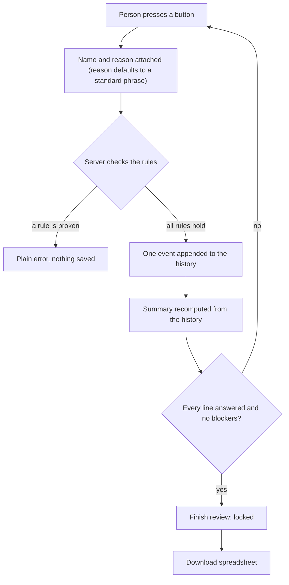

# Gate 6: What a person decides, and what is saved

[Back to the map](README.md) | Previous: [Gate 5](05-the-review-screen.md) | Next: [Gate 7, the Safety Net](07-safety-net.md)

## In one minute
**The app suggests; a person decides.** Every product line needs one saved answer from a named person. Each answer is written to a history that nobody, not even the app, can edit or delete afterwards. When all lines are answered the person presses **Finish review**, which locks the review. The confirmed products can then be downloaded as a spreadsheet (CSV). Quantities are shown in one standard format, but the printed text is always kept next to it.

## What a person can decide
| Decision (button) | Saved as | What it means |
| --- | --- | --- |
| **Confirm** / "This is the product" | `approve` | This line is this catalog product |
| Pick a product from the search | `this_is_product` | Choose a product for the line; it still needs Confirm |
| Add a new product | `new_product` | Create a product (marked "Added by a reviewer"); it still needs Confirm |
| **Not a product** | `not_a_product` | The line is not something we sell |
| Correct a value (one-line view, "Something misread?") | `correct` | Replace a quantity, unit, price, description or code reading; the printed value stays on record and the earlier Confirm no longer counts |
| "I checked this page" / "I read these warnings" | `acknowledge_page`, `acknowledge_document` | Needed before Finish when a page was only partly read or the reading carried warnings |
| **Finish review** | `resolve` | Locks the review |

(`ReviewRequest` in `backend/api_models.py`; the older `no_match`, `acknowledge` and `propose_candidate` actions still exist on the server. An older alias `not_product` is kept for old records.)

## How a decision becomes saved data


## The rules the server checks first (`review_run` in `backend/service.py`)
- The line's evidence must be the line's own page and rectangle, never another line's.
- A continuation line or a totals/notes line cannot be approved, excluded or classified as a product.
- The chosen product must be in the candidate list saved for that line, or be one a person explicitly chose or added for that line; it must be active and inside the catalog scope of the run.
- An Uncertain line cannot be approved until one of the three answers has been saved for it, and "no match" is refused for it.
- A "new product" needs a stable key, so a double click never creates two products; the same key with different content is refused.
- After **Finish**, nothing more can be saved on that run; changing anything needs a new reading.

**Finish is blocked** (`resolution_blockers` in `backend/review_summary.py`) while: any product or unknown line is unanswered; any page failed (needs a new reading); a partly read page has not been acknowledged; or the reading carries warnings that have not been acknowledged.

## What is saved, and why it can be trusted
Each answer is a row in `review_events` (`ReviewEvent`, `backend/models.py`): who (reviewer name), when, why (reason), which line, which evidence rectangle, the old value, the new value, the chosen product, and a running sequence number per run. The database itself rejects any later `UPDATE` or `DELETE` on these rows (trigger `review_events_immutable`, migration `0002_local_backend.py`), and the same holds for the saved candidate lists, source document records and catalog products. Once the model's answer is stored on the run (`run.result`), a database trigger (`processing_runs_guard`) refuses to change it: corrections are separate events laid over it. The person can open "Review history" under Details to see every event.

## The spreadsheet (CSV)
Made in the browser from the confirmed products (`downloadCSV` in `web/local-reader/workflow.js`). File name `confirmed-products.csv`, UTF-8 with a byte-order mark so Excel shows accents correctly. Seven columns, documented in `docs/poc-demo-runbook.md`:

`product_id, product, description, quantity, unit, quantity_as_printed, price`

- Only confirmed products are in it. Lines marked not a product, unanswered lines and device-only flags are not.
- A cell that starts with `=`, `+`, `@` or a tab or carriage return (or `-` followed by text) gets a leading apostrophe so a spreadsheet cannot run it as a formula.
- `description` is the printed text (continuation lines joined on). Nothing is invented: a value that was not printed is blank.

### Quantity standardization
The page shows quantities in one format (`normalizeQuantity` in `web/local-reader/app.js`). The printed text is never changed in storage, in the server answer or in the history.

| Printed | Shown and exported as `quantity` | Note |
| --- | --- | --- |
| `2`, `002.00`, `2.5000` | `2.00`, `2.00`, `2.50` | Leading zeros and extra zero decimals removed |
| `3 EA`, `3EA` | `3.00` and unit `EA` | A unit written next to the number is split off |
| `1,5` | `1.50` | One comma with one or two digits is read as a decimal point |
| `1,000`, `1.000` | blank, shown as printed with a "Check" flag | Could be one thousand or one: the app does not guess |
| `2.555`, `1,234,567`, `2-3`, `2 x 4`, `N/A` | blank, shown as printed with a "Check" flag | Not guessed |

`quantity_as_printed` always holds the original text. A person's correction of quantity or unit replaces the value shown and exported, while the original stays in the history.

## Worked example (invented)
Order `PO-TEST-004`: line 1 `ACME-1001`, quantity `020.00`, unit `EA`, price `3.40`; line 2 `ACME-2001`, quantity `1,000`; line 3 `Freight charge`. A person, "Sam Test", confirms line 1, confirms line 2, and ignores line 3 (it needs nothing). Summary reads "2 products confirmed". The CSV:

```
"product_id","product","description","quantity","unit","quantity_as_printed","price"
"ACME-1001","Brass hinge 50mm","ACME-1001 Brass hinge 50mm","20.00","EA","020.00","3.40"
"ACME-2001","Steel bolt M8x40, box of 100","Steel bolts M8 x 40","","","1,000",""
```
(The app wraps every cell, header included, in quotes. The second quantity is blank because `1,000` is ambiguous. The history holds two `approve` events by "Sam Test".)

## What a person sees
- Toasts such as "Confirmed." and "Moved to Not products."; a progress bar; a Summary with "N products confirmed" and a table (ID, Product, Qty, Price, with "As printed:" underneath).
- Under **Details**: the source file name, its SHA-256 fingerprint, the run id, and "Review history · N event(s)".
- "One last step: Finish the review to lock your answers. They cannot be changed afterwards."

## Honest limits
- The reviewer's name is typed by the person and saved on the device. There are no logins in version 1, so the name is an attribution, not proof of identity.
- The CSV is produced in the browser. I found no automated test of the CSV's exact contents (not verified); the quantity rules are tested.
- Flags set on totals and notes lines stay on the device and never reach the server or the CSV ([gate 2](02-sorting-each-line.md)).

## Where it lives
- `backend/service.py` (`review_run`), `backend/api_models.py` (`ReviewRequest`), `backend/review_answers.py` (the three answers), `backend/review_summary.py` (`reviewed_summary`, `resolution_blockers`), `backend/models.py` (`ReviewEvent`), `backend_migrations/versions/0002_local_backend.py` (append-only triggers), `backend_migrations/versions/0005_review_sequence.py`.
- `web/local-reader/workflow.js` (`renderSummary`, `downloadCSV`, `csvCell`, `postReview`), `web/local-reader/app.js` (`normalizeQuantity`, `quantityDisplay`).

## Built by PR
[#7](https://github.com/CarlitosRed/advance-po-reader/pull/7) (explicit three answers, the approval rules); [#13](https://github.com/CarlitosRed/advance-po-reader/pull/13) (summary screen, spreadsheet, standard quantity format); [#16](https://github.com/CarlitosRed/advance-po-reader/pull/16) (answers from the tab cards). The history table and its triggers were built before these PRs (exact PR not verified).

## How we know it works
- Tests: `tests/goal/test_goal_answers.py` (a chosen product still needs approval; a new product is idempotent and marked; a correction needs fresh approval; an Uncertain line cannot finish with "no match"), `tests/goal/quantity.cjs` with `tests/goal/test_goal_quantity.py` (the table above), `tests/backend/test_review_summary.py`, `tests/backend/test_api_integration.py` (append-only corrections, review needs every line), `tests/backend/test_db_workflow_guards.py` (review order follows insertion, not clock).
- Reviews: #13 Approved at `9b69c4e`; #16 Approved at `906dbef`. Both by Codex.
- No measured accuracy applies to this gate: it records human decisions. Not measured: how many events a typical order produces, and time per order.

## Status
In version 1.
