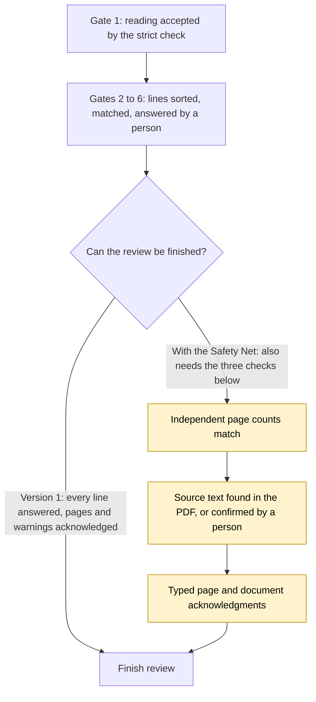

# Gate 7: The Safety Net (independent checks) - built, approved, NOT in version 1

[Back to the map](README.md) | Previous: [Gate 6](06-decisions-and-saved-data.md) | Next: [Gate 8, how a change gets in](08-how-a-change-gets-in.md)

> **Status: built and approved, but not part of version 1.** The code lives in PR #9, which is not in the base this documentation was written against (`integration/ui-and-matching`). Carlos decided on 2026-10-06 that the Safety Net moves to version 2 (`decisions.md`). Everything below that describes what the Safety Net does was read from the PR #9 branch (`codex/close-goal-gaps-b`, head `100f1d8`), not from this base.

## In one minute
Everything in gates 1 to 6 relies on the AI model telling the truth about what is on the page. The Safety Net adds **checks that do not trust the model**:

1. **Independent page counts.** For each page a person counts the product lines themselves and enters the number. If it differs from the number of product lines the model found, the review cannot be finished; the fix is a new reading.
2. **Source-text check.** For PDFs that have a text layer, the app reads the text inside the rectangle the model pointed to and checks that the model's description and codes really appear there. Text the model "saw" that is not in the PDF is flagged.
3. **Typed acknowledgments.** "I checked this page" and "I read these warnings" become precise records that name the page, the file fingerprint and the run, and they can never replace the two checks above.

**What version 1 has instead:** the model's own statement of which pages were complete, the strict check of gate 1, the snapshots and a human looking at every line. In version 1 nothing independently counts the product lines or compares the model's text with the PDF's own text. A line the model skipped entirely would not be flagged by the app.

## How the Safety Net sits in the flow

Amber boxes are not in version 1.

## Worked example (invented)
Order `PO-TEST-005`, one page, printed with 5 product lines.
- The model reports 4 product lines. The reviewer counts 5 and enters "5". Result: **mismatch**, Finish is blocked, and the remedy offered is a new reading of the same file. The old reading, its decisions and the count stay on record. A count can be corrected only with a new, attributed, reasoned record that says the count itself was wrong; it cannot be lowered to make it match.
- The model wrote the description "Brass hinge 75mm" for line 2, but the text inside that line's rectangle in the PDF reads "Brass hinge 50mm". Result: **unsupported**; a person must review that line against the source (an audited "confirm source text" action) before Finish. The model's wording is kept as it was; nothing is rewritten.
- Page 1 is a scanned photo with no text layer. Result: **unavailable**, which is not treated as proof of an error; the line keeps its tier, and one attributed confirmation for the page covers all affected lines.

## What the checks do exactly (from the PR #9 branch)
- **Counts** (`backend/coverage.py`, `page_coverage`): per page, the number of product items the model produced (continuations, totals and notes excluded) against the latest reviewer count bound to that page and file fingerprint. No count yet = "unavailable", different = "mismatch", equal = "matched". A count of zero on a page with product lines is a mismatch. A reviewer-reported source discrepancy keeps the old reading blocked permanently. Blockers: `independent_page_product_counts_required`, `page_product_count_mismatch_requires_new_run`.
- **Source text** (`backend/source_checks.py`, `source_grounding`): reads the text inside each cited rectangle with the PDF library (`pymupdf`), lower-cases and collapses spaces on both sides, and requires the model's text as a whole phrase with word boundaries. No fuzzy matching and no searching other places to rescue a failed comparison. Statuses: supported, unsupported, unavailable. Blockers: `unsupported_product_text_requires_source_review`, `unavailable_page_text_requires_confirmation`.
- **Acknowledgments** (item 6 of the PR): the two kinds name different things. A **page** acknowledgment names one page number and the exact file fingerprint, and the page must be one the model marked partial (otherwise `only_partial_pages_can_be_acknowledged`). A **document** acknowledgment names no page: it carries the source document ID, the run ID and the file fingerprint, and it is the record used to acknowledge the reading's warnings. Both must match the saved file's fingerprint ([`api_models.py` lines 13-27 and 126-131](https://github.com/CarlitosRed/advance-po-reader/blob/100f1d83bb385aeeb55527b7beb2fb675cdf916b/backend/api_models.py#L13-L27); [`service.py` lines 289-306](https://github.com/CarlitosRed/advance-po-reader/blob/100f1d83bb385aeeb55527b7beb2fb675cdf916b/backend/service.py#L289-L306)).
- **Labeled codes** (item 6 of the PR): code words explicitly labeled in a description (such as "Code: A123") are looked up as exact catalog codes, at most 10 per line and at most 40 characters each. They are tried only when the printed identifiers found no product, and they use exact equality, not the normalized form ([`catalog.py` lines 40-45, 184-196 and 322-334](https://github.com/CarlitosRed/advance-po-reader/blob/100f1d83bb385aeeb55527b7beb2fb675cdf916b/backend/catalog.py#L184-L196)).
- None of the three can approve a product or clear another blocker; products still need their own confirmation ([gate 6](06-decisions-and-saved-data.md)).

## What a person would see
In PR #9's version of the summary screen (`web/local-reader/workflow.js` on that branch): for each page, a box "Page N, product count: matched / mismatch / unavailable" showing "Extracted product items" next to "Independent source count" with a field "Products on this source page"; for each flagged line, "independent source text unsupported" with a button to save an attributed source review; for a page without text, a notice with a page confirmation button. Putting these into the three-tab screen is a separate plan, PR #20 (below), which is also not in version 1.

## Where it lives (PR #9 branch, not this base)
[`backend/coverage.py`](https://github.com/CarlitosRed/advance-po-reader/blob/100f1d83bb385aeeb55527b7beb2fb675cdf916b/backend/coverage.py), [`backend/source_checks.py`](https://github.com/CarlitosRed/advance-po-reader/blob/100f1d83bb385aeeb55527b7beb2fb675cdf916b/backend/source_checks.py), changes in [`backend/service.py`](https://github.com/CarlitosRed/advance-po-reader/blob/100f1d83bb385aeeb55527b7beb2fb675cdf916b/backend/service.py), [`backend/review_summary.py`](https://github.com/CarlitosRed/advance-po-reader/blob/100f1d83bb385aeeb55527b7beb2fb675cdf916b/backend/review_summary.py), [`backend/api_models.py`](https://github.com/CarlitosRed/advance-po-reader/blob/100f1d83bb385aeeb55527b7beb2fb675cdf916b/backend/api_models.py), [`backend/responses.py`](https://github.com/CarlitosRed/advance-po-reader/blob/100f1d83bb385aeeb55527b7beb2fb675cdf916b/backend/responses.py), [`backend/catalog.py`](https://github.com/CarlitosRed/advance-po-reader/blob/100f1d83bb385aeeb55527b7beb2fb675cdf916b/backend/catalog.py), [`web/local-reader/workflow.js`](https://github.com/CarlitosRed/advance-po-reader/blob/100f1d83bb385aeeb55527b7beb2fb675cdf916b/web/local-reader/workflow.js); plan in [`docs/goal-gaps-pr-b-plan.md`](https://github.com/CarlitosRed/advance-po-reader/blob/100f1d83bb385aeeb55527b7beb2fb675cdf916b/docs/goal-gaps-pr-b-plan.md); measured scorecard in [`docs/goal-scorecard-2026-10-05.md`](https://github.com/CarlitosRed/advance-po-reader/blob/100f1d83bb385aeeb55527b7beb2fb675cdf916b/docs/goal-scorecard-2026-10-05.md) on that branch.

## Built by PR
[#9](https://github.com/CarlitosRed/advance-po-reader/pull/9) (draft; items 3, 4 and 6; base `codex/worktree-standards`). [#20](https://github.com/CarlitosRed/advance-po-reader/pull/20) (draft; a plan to bring these controls into the three-tab screen; plan only). [#17](https://github.com/CarlitosRed/advance-po-reader/pull/17) (reading pages in parallel) is also version 2 and unrelated to the Safety Net.

## How we know it works
- Reviews on #9: item 3 approved at `53a092d` and item 4 at `1ca8c03` by Claudio PR review; item 6 approved at `100f1d8` by Codex PR review.
- The goal suite on that branch reports **145 passed, 0 failed, 0 blocked** (its own scorecard, run locally on fictional PDFs and a fake model). This proves the controls behave as designed. It measures no real-document or model accuracy.
- Not measured: how many real mistakes the counts or the text check would catch, how much extra time they add per order, or how they behave on scanned originals.

## Status
**Built, not in version 1.** Version 2 card V2-1 (`tasks/v2-backlog.md`, project notes). Merging it also needs Carlos's word and the merge gate ([gate 8](08-how-a-change-gets-in.md)).
