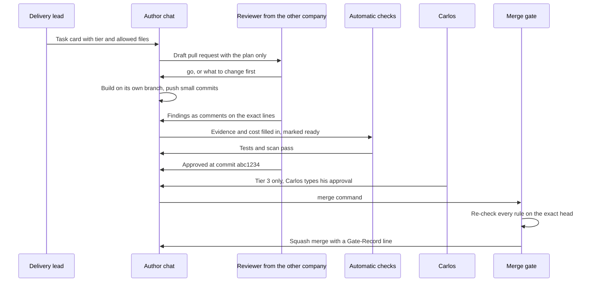
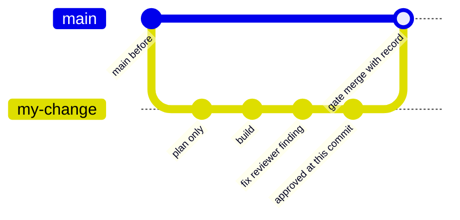
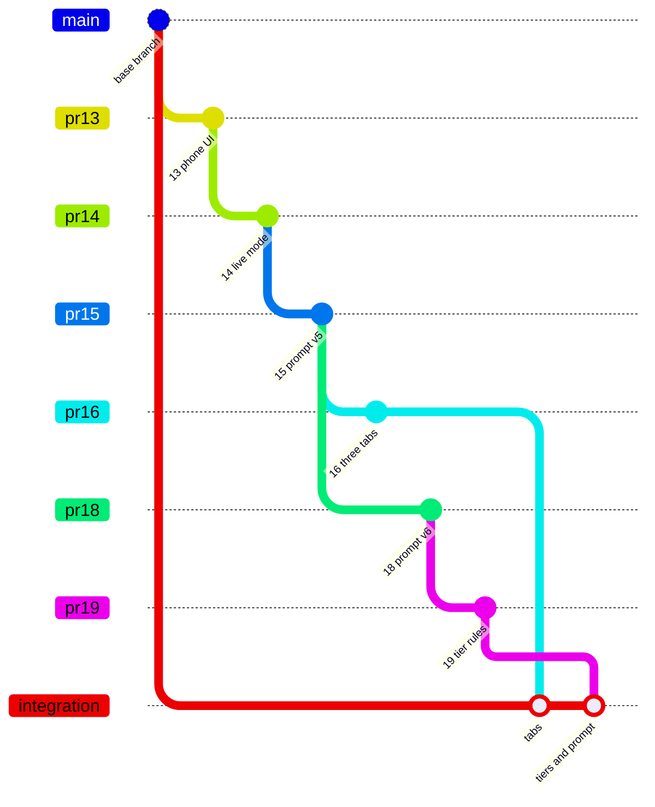

# Gate 8: How a change gets into the project

[Back to the map](README.md) | Previous: [Gate 7](07-safety-net.md) | [Glossary](glossary.md)

> Where this comes from: the working rules are in `ROLES.md` and `tools/gate/` on the `main` branch (added by PR #10, merged 2026-10-05, commit `427be1e`). This page was first written against the integration branch `integration/ui-and-matching`, which did not have them, so the links below point at the text as it stood on `main` at the time, and I read them there. Version 1 has since landed on `main` (commit `3e23801`, tag `poc-v1`).
>
> **Update 2026-10-15:** the gate program itself cut over to a shared, framework-pinned tool (`tools/gate/gate.py` at `.orchestration/framework.pin`'s tag, reading `.orchestration/gate.json`). The mechanism described below (one gate program, checked against the current head, writing a record) is unchanged; only which file implements it changed. `tools/gate/po_gate.py`, the file this page's links below point at, is this project's own retired predecessor -- kept in the repo, no longer invoked by CI, the hook, or `ROLES.md`'s merge step.

## In one minute
Nobody changes the project directly. Every change is a **pull request**: a proposed change that other people (and other AIs) can read before it lands. The rules:

1. The **author** (a person or an AI chat) works on its own branch and in its own copy of the folder.
2. A **different** reviewer from the **other AI company** reads the change and writes either "go" on the plan, or "Approved at `<commit>`" on the exact version it checked. Anthropic's Claude work is reviewed by OpenAI's Codex, and the reverse. The author never approves its own work.
3. **Automatic checks** (CI) run the tests and scan for forbidden files and secrets.
4. For changes that touch money or trust (the rules, the model prompt, scripts, security files), **Carlos** types his own approval.
5. The merge happens only through a small **gate** program that checks all of the above against the exact version being merged and writes a record into the history. (This is the rule for landing on `main`. The version 1 route into the integration branch is the one exception; see the table below.)
6. Any new push after an approval cancels the approval: the reviewer must look again.

## One change, start to finish

## How the history looks
One change on its way in. A later push would cancel the approval, so the approved commit is the last one before the merge:

The version 1 stack is a chain of pull requests, each opened on top of the previous one. Before and after landing it on the integration branch:

| | Before | After (today) |
| --- | --- | --- |
| Where the v1 code is | Spread over six stacked pull requests (#13, #14, #15, #16, #18, #19), plus #21. Five of the six have their own approval by Codex; #14 has none of its own and merges as a stack with #15 (the private project notes, not in this repository, 2026-10-07). #21 was approved by Codex at `51e79cc` | Together on `main` (version 1 landed as commit `3e23801`, tag `poc-v1`). Before that, on the branch `integration/ui-and-matching` (head `a76aa4a`; it contains #21 as `a9c6fe3`), which still exists but is no longer the place to clone |
| In `main` | No | **Yes.** Version 1 landed on `main` as commit `3e23801` and is tagged `poc-v1` |
| Done for version 1 | | Carlos's choice (recorded 2026-10-07 in the private project notes, not in this repository): PR #21 was merged into `integration/ui-and-matching` as `a9c6fe3`, **without the merge gate** (the gate only merges pull requests aimed at `main`); the merge commit's message says "Merged into integration/ui-and-matching on Carlos's option A (no gate, not main)". |
| Tag | | `poc-v1` marks the landing commit on `main` |
| Landing on `main` | | Went through the pull request, review and merge gate described below, with Carlos typing the Tier 3 approvals himself |

## The three levels (tiers) of a change
From `ROLES.md`. Every pull request carries exactly one label.

| Tier | What it covers | Needs plan "go" | Needs approval | Needs Carlos |
| --- | --- | --- | --- | --- |
| 1 | Only the `docs` folder and `README.md` | no | none | no |
| 2 | Code, tests, configuration | yes | one, from the other company | no |
| 3 | Money and trust: `AGENTS.md`, `ROLES.md`, `PROJECT_GOAL.md`, `.github`, the gate, `backend/providers.py` (the model prompt), `scripts`, database migrations and a few more (exact list: `protected_paths` in `tools/gate/gate.json`) | yes | one, from the other company | yes, he types it himself |
| 4 | Billing, spend limits, credentials, production, deleting data | not a pull request | not a pull request | humans only |

The gate raises a label that is too low and never lowers one. A documentation-only change that touches only `docs/` and `README.md` is in the Tier 1 area and goes into `main` through the normal merge gate.

## What the merge gate checks (`tools/gate/po_gate.py check <PR>`)
State (open, not a draft, aimed at `main`); no active `hold` from anyone; a valid tier label; no forbidden files (PDFs, images, model files, keys, `.env*`, data folders) and fewer than 100 changed files; the required automatic checks passed on the exact head (`tests`, `gate-tests`, `scan`); for Tiers 2 and 3 a plan section, an evidence section and a cost section, a signed "go", and a signed "Approved at `<commit>`" matching the head from the other company; for Tier 3 Carlos's own approval of that commit. `merge` then squash-merges that exact commit and writes `Gate-Record: pass tier=N head=... reviewers=... owner=... by=...` into the history. The `Gate audit` workflow runs after every push to `main` and opens an issue if any new commit lacks that record.

## What can still go wrong (honest limits, stated in `ROLES.md`)
- **Everyone posts as one GitHub account.** Chats sign their comments by name (for example "Codex · PR review:"), but the gate cannot prove who wrote a comment, and comments can be edited. Carlos's `hold` and the audit are the backstop.
- **The gate cannot stop a manual merge** by someone holding the account's credentials; the audit would flag it afterwards.
- **It checks the commit, not the code.** A reviewer who approves a bad change still approves it.
- A merge conflict can silently void an approval; PR #11 (T-012) is the open fix, and it is a version 2 item.

## What the automatic checks are
On `main`: `backend-goal-checks.yml` (job `backend-goal`: the whole backend test suite and the "goal" acceptance suite against a throwaway PostgreSQL database, with no browser installed), `gate-a-checks.yml` (job `gate-a`: the older foundation tests) and `python-checks.yml` (job `tests`: the oldest unit tests). Each runs on a push and on a pull request, which is why a "6 of 6 green" report means three jobs run twice. There are also `gate-tests` and `scan` (tests of the gate itself and a search for forbidden files and secrets) and the `Gate audit` workflow. A pre-push hook (`.githooks/pre-push`) scans before code leaves a computer.

## The people and chats (from `ROLES.md`)
| Name | Role | Company |
| --- | --- | --- |
| Carlos | Technical owner; vetoes with `hold`; approves Tier 3; owns billing, keys, production, deletion | human |
| Claudio PM | Delivery lead: task cards, briefs, the only writer of shared notes | Anthropic |
| Claudio IT | Platform and release: folders, GitHub housekeeping, CI, the gate | Anthropic |
| Claudio PR review / Codex PR review | Independent reviewers; never push or merge | Anthropic / OpenAI |
| Codex task chats, Chat task chats | Builders, one task each | OpenAI |
| Claude task chats, such as "Claude · poc ui" (names seen in this project's pull requests; not listed in `ROLES.md`) | Builders, one task each | Anthropic |

## Where it lives
- Rules and phrases: [`ROLES.md`](https://github.com/CarlitosRed/advance-po-reader/blob/427be1e2abe3e51759b30a623df66c014351db55/ROLES.md) (on `main`). Product rules: [`AGENTS.md`](https://github.com/CarlitosRed/advance-po-reader/blob/742666345a97dd00c1ed0d9e1ab725618bed3110/AGENTS.md) and [`PROJECT_GOAL.md`](https://github.com/CarlitosRed/advance-po-reader/blob/742666345a97dd00c1ed0d9e1ab725618bed3110/PROJECT_GOAL.md) (both are on `main`; the links pin the earlier commit this page was written against).
- Gate program, its settings and tests: [`tools/gate/po_gate.py`](https://github.com/CarlitosRed/advance-po-reader/blob/427be1e2abe3e51759b30a623df66c014351db55/tools/gate/po_gate.py), [`tools/gate/gate.json`](https://github.com/CarlitosRed/advance-po-reader/blob/427be1e2abe3e51759b30a623df66c014351db55/tools/gate/gate.json), [`tools/gate/test_po_gate.py`](https://github.com/CarlitosRed/advance-po-reader/blob/427be1e2abe3e51759b30a623df66c014351db55/tools/gate/test_po_gate.py), [`tools/gate/README.md`](https://github.com/CarlitosRed/advance-po-reader/blob/427be1e2abe3e51759b30a623df66c014351db55/tools/gate/README.md) (on `main`).
- CI: [`.github/workflows/`](https://github.com/CarlitosRed/advance-po-reader/tree/742666345a97dd00c1ed0d9e1ab725618bed3110/.github/workflows) (pinned to the earlier commit; `main` also has the gate jobs).
- Folder rules for builders (one chat per folder, no shared data, backups): [`docs/worktree-standards.md`](https://github.com/CarlitosRed/advance-po-reader/blob/742666345a97dd00c1ed0d9e1ab725618bed3110/docs/worktree-standards.md).
- Handoff note per task: [`docs/agent-handoff.md`](https://github.com/CarlitosRed/advance-po-reader/blob/742666345a97dd00c1ed0d9e1ab725618bed3110/docs/agent-handoff.md).

## Built by PR
[#10](https://github.com/CarlitosRed/advance-po-reader/pull/10) (the operating model and the gate; merged into `main`); [#11](https://github.com/CarlitosRed/advance-po-reader/pull/11) (conflict guard; open, version 2).

## How we know it works
- The gate has its own tests (`tools/gate/test_po_gate.py`, run in CI as `gate-tests`) that use a pretend `gh` and temporary repositories and never contact GitHub (per `tools/gate/README.md`).
- Reviews of PR #10 are recorded in the project notes; I did not re-read them for this page. Whether every merge so far carried a `Gate-Record` line: not verified.
- Example from this project of the rules working: PR #19 was **Not approved** twice (at `4bb8edb` and at `fd14250`) for real defects (a prefix rule that hid a second product; a skipped check that relaxed the rules), fixed, then **Approved at `9cc9aca`**. See [gate 4](04-confidence-tiers.md).
- Not measured: review turnaround time or cost per pull request.

## Status
In use (PR #10 is on `main`). The version 1 route was different from the general rules above: PR #21 went into the integration branch with no gate (merged as `a9c6fe3`); the landing on `main` (commit `3e23801`, tag `poc-v1`) then went through the gate.
