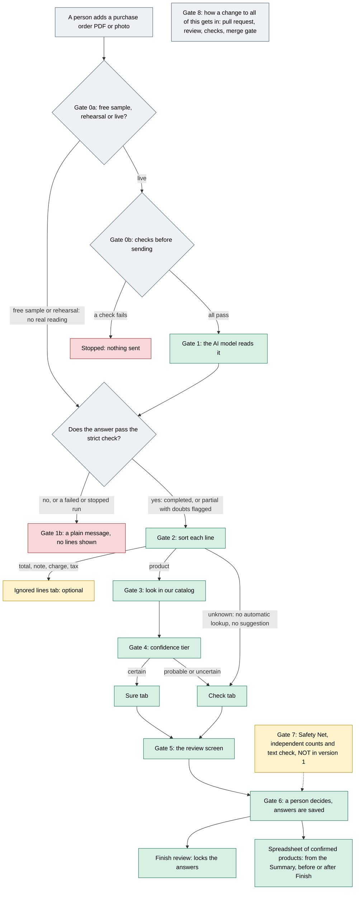

# How the Advance PO Reader works, in plain language

You do not need to program, or know anything about AI, to follow this. The app reads a customer's purchase order (a PDF), turns each printed line into a suggestion from our product list, and **a person confirms every product**. This folder explains each decision the app makes along the way, one short page per decision ("gate"). Gates 0a and 0b come before the reading, and 1b covers what happens when a reading does not finish, with a small picture, an invented example, and links to the pull request (the proposed change) and to the code that does it. Code links point at fixed commits, so they keep showing exactly what was read: `a76aa4a` (the stack with PR #21) or the earlier base `7426663`, and, for the files that live only elsewhere, the commit of PR #9 or of `main`. Every link that still points at `7426663` was checked to lead to a file with the same content at `a76aa4a`.

All examples in these pages are invented (codes such as `ACME-1001`). No real order, customer, supplier or catalog code appears here.

**Written against:** the version 1 stack on the branch `integration/ui-and-matching` at commit `a76aa4a` (date of writing: 2026-10-07). That commit contains PR #21 (merged as `a9c6fe3`). Code links to the version 1 stack use `a76aa4a` or the earlier commit `7426663`. Every link that still uses `7426663` was compared (git blob) with the same path at `a76aa4a` and the content is identical; links to the files PR #21 changed use `a76aa4a`. Anything that is not in that stack is marked "not in version 1". Version 1 has since landed on `main` (commit `3e23801`, tag `poc-v1`); the pins below were not changed.

## The whole flow on one page

Green is in version 1. Amber is optional or not in version 1. Red is a stop. Gray is structure.

Two kinds of line skip the catalog lookup: totals, notes, charges and taxes (they never need an answer), and "unknown" lines (the model could not tell what they are; they always start in Check with no suggestion, and a person must pick a product, add one, or say it is not a product). The spreadsheet does not wait for Finish: once every line has an answer, the Summary offers the download, and Finish is a separate step that locks the answers.

Two rules hold at every step: **the app never approves a product by itself** (even "Sure" needs a person's confirm), and **what was printed is never rewritten** (corrections are saved next to it).

## The gates
| Gate | What it decides | Page | Pull request | Main code files | Status |
| --- | --- | --- | --- | --- | --- |
| 0a | Free sample, rehearsal or live: where the answer comes from | [0a](00a-three-ways-to-run.md) | [#12](https://github.com/CarlitosRed/advance-po-reader/pull/12), [#14](https://github.com/CarlitosRed/advance-po-reader/pull/14) | [`scripts/poc-demo.py`](https://github.com/CarlitosRed/advance-po-reader/blob/a76aa4a866e2929cb3cead1109b1b9391b3e9279/scripts/poc-demo.py), [`scripts/poc_demo_support.py`](https://github.com/CarlitosRed/advance-po-reader/blob/a76aa4a866e2929cb3cead1109b1b9391b3e9279/scripts/poc_demo_support.py), [`scripts/poc_live_support.py`](https://github.com/CarlitosRed/advance-po-reader/blob/742666345a97dd00c1ed0d9e1ab725618bed3110/scripts/poc_live_support.py) | In version 1 |
| 0b | The checks before anything is sent: file, permission, cost limit | [0b](00b-checks-before-sending.md) | [#14](https://github.com/CarlitosRed/advance-po-reader/pull/14) | [`backend/uploads.py`](https://github.com/CarlitosRed/advance-po-reader/blob/742666345a97dd00c1ed0d9e1ab725618bed3110/backend/uploads.py), [`backend/service.py`](https://github.com/CarlitosRed/advance-po-reader/blob/742666345a97dd00c1ed0d9e1ab725618bed3110/backend/service.py), [`scripts/poc_live_support.py`](https://github.com/CarlitosRed/advance-po-reader/blob/742666345a97dd00c1ed0d9e1ab725618bed3110/scripts/poc_live_support.py) | In version 1 |
| 1 | Reading the PDF with the AI model, and the strict check of its answer | [01](01-reading-the-pdf.md) | [#14](https://github.com/CarlitosRed/advance-po-reader/pull/14), [#15](https://github.com/CarlitosRed/advance-po-reader/pull/15), [#18](https://github.com/CarlitosRed/advance-po-reader/pull/18) | [`backend/providers.py`](https://github.com/CarlitosRed/advance-po-reader/blob/742666345a97dd00c1ed0d9e1ab725618bed3110/backend/providers.py), [`backend/contracts.py`](https://github.com/CarlitosRed/advance-po-reader/blob/742666345a97dd00c1ed0d9e1ab725618bed3110/backend/contracts.py), [`backend/service.py`](https://github.com/CarlitosRed/advance-po-reader/blob/742666345a97dd00c1ed0d9e1ab725618bed3110/backend/service.py) | In version 1 |
| 1b | When a reading fails, stops or finishes partly, and when a new reading is needed | [1b](01b-when-a-reading-fails-or-stops.md) | [#14](https://github.com/CarlitosRed/advance-po-reader/pull/14), [#15](https://github.com/CarlitosRed/advance-po-reader/pull/15) | [`backend/service.py`](https://github.com/CarlitosRed/advance-po-reader/blob/742666345a97dd00c1ed0d9e1ab725618bed3110/backend/service.py) (`process_run`, `cancel_run`), [`gate_a/contracts.py`](https://github.com/CarlitosRed/advance-po-reader/blob/742666345a97dd00c1ed0d9e1ab725618bed3110/gate_a/contracts.py) | In version 1 |
| 2 | Sorting each line: product, or total, note, charge, tax | [02](02-sorting-each-line.md) | [#15](https://github.com/CarlitosRed/advance-po-reader/pull/15), [#16](https://github.com/CarlitosRed/advance-po-reader/pull/16); [#21](https://github.com/CarlitosRed/advance-po-reader/pull/21) renamed the tab | [`backend/contracts.py`](https://github.com/CarlitosRed/advance-po-reader/blob/742666345a97dd00c1ed0d9e1ab725618bed3110/backend/contracts.py), [`backend/review_summary.py`](https://github.com/CarlitosRed/advance-po-reader/blob/742666345a97dd00c1ed0d9e1ab725618bed3110/backend/review_summary.py), [`web/local-reader/workflow.js`](https://github.com/CarlitosRed/advance-po-reader/blob/a76aa4a866e2929cb3cead1109b1b9391b3e9279/web/local-reader/workflow.js) | In version 1 |
| 3 | Finding the product in our catalog | [03](03-finding-the-product.md) | [#18](https://github.com/CarlitosRed/advance-po-reader/pull/18), [#19](https://github.com/CarlitosRed/advance-po-reader/pull/19) | [`backend/catalog.py`](https://github.com/CarlitosRed/advance-po-reader/blob/742666345a97dd00c1ed0d9e1ab725618bed3110/backend/catalog.py), [`backend/service.py`](https://github.com/CarlitosRed/advance-po-reader/blob/742666345a97dd00c1ed0d9e1ab725618bed3110/backend/service.py) | In version 1 |
| 4 | The confidence tiers: certain, probable, uncertain | [04](04-confidence-tiers.md) | [#7](https://github.com/CarlitosRed/advance-po-reader/pull/7), [#19](https://github.com/CarlitosRed/advance-po-reader/pull/19) | [`backend/tiers.py`](https://github.com/CarlitosRed/advance-po-reader/blob/742666345a97dd00c1ed0d9e1ab725618bed3110/backend/tiers.py) | In version 1 |
| 5 | The review screen: Sure, Check, Ignored lines, snapshots | [05](05-the-review-screen.md) | [#16](https://github.com/CarlitosRed/advance-po-reader/pull/16), [#13](https://github.com/CarlitosRed/advance-po-reader/pull/13); plain reasons, check-mark and Ignored lines in [#21](https://github.com/CarlitosRed/advance-po-reader/pull/21) | [`web/local-reader/workflow.js`](https://github.com/CarlitosRed/advance-po-reader/blob/a76aa4a866e2929cb3cead1109b1b9391b3e9279/web/local-reader/workflow.js), [`web/local-reader/app.js`](https://github.com/CarlitosRed/advance-po-reader/blob/a76aa4a866e2929cb3cead1109b1b9391b3e9279/web/local-reader/app.js) | In version 1 |
| 6 | What a person decides and what is saved: answers, history, spreadsheet, quantity format | [06](06-decisions-and-saved-data.md) | [#7](https://github.com/CarlitosRed/advance-po-reader/pull/7), [#13](https://github.com/CarlitosRed/advance-po-reader/pull/13), [#16](https://github.com/CarlitosRed/advance-po-reader/pull/16) | [`backend/service.py`](https://github.com/CarlitosRed/advance-po-reader/blob/742666345a97dd00c1ed0d9e1ab725618bed3110/backend/service.py) (`review_run`), [`backend/review_summary.py`](https://github.com/CarlitosRed/advance-po-reader/blob/742666345a97dd00c1ed0d9e1ab725618bed3110/backend/review_summary.py), [`backend/review_answers.py`](https://github.com/CarlitosRed/advance-po-reader/blob/742666345a97dd00c1ed0d9e1ab725618bed3110/backend/review_answers.py), [`web/local-reader/workflow.js`](https://github.com/CarlitosRed/advance-po-reader/blob/a76aa4a866e2929cb3cead1109b1b9391b3e9279/web/local-reader/workflow.js) | In version 1 |
| 7 | The Safety Net: independent page counts, source-text check, typed acknowledgments | [07](07-safety-net.md) | [#9](https://github.com/CarlitosRed/advance-po-reader/pull/9) (plan to join the tabs: [#20](https://github.com/CarlitosRed/advance-po-reader/pull/20)) | [`backend/coverage.py`](https://github.com/CarlitosRed/advance-po-reader/blob/100f1d83bb385aeeb55527b7beb2fb675cdf916b/backend/coverage.py), [`backend/source_checks.py`](https://github.com/CarlitosRed/advance-po-reader/blob/100f1d83bb385aeeb55527b7beb2fb675cdf916b/backend/source_checks.py) (only on the #9 branch) | **Built, approved, NOT in version 1** |
| 8 | How a change gets in: branches, pull requests, reviews by another AI, checks, the merge gate | [08](08-how-a-change-gets-in.md) | [#10](https://github.com/CarlitosRed/advance-po-reader/pull/10) (merged), [#11](https://github.com/CarlitosRed/advance-po-reader/pull/11) (open, version 2) | [`ROLES.md`](https://github.com/CarlitosRed/advance-po-reader/blob/427be1e2abe3e51759b30a623df66c014351db55/ROLES.md), [`tools/gate/`](https://github.com/CarlitosRed/advance-po-reader/tree/427be1e2abe3e51759b30a623df66c014351db55/tools/gate) (on `main`) | In use |

Also: [Glossary](glossary.md) (tier, catalog, alias, SKU and other words).

## What version 1 is, in numbers
Measured by running the stored readings of the 33 sample orders, with no new spending (from the private project notes, not in this repository, 2026-10-06; the product list used was built from these same orders, so brand-new orders are likely to do worse):

| | Measured on the 33 sample orders |
| --- | --- |
| Orders with a reading accepted for review | 33 of 33 (five of them ended `partial`, "review required", not fully completed) |
| Product lines found (matches the reference count for every order) | 150 |
| Lines the app calls Certain (start in Sure) | 120 of 150 |
| Lines the app calls Probable | 13 |
| Lines the app calls Uncertain | 19 (17 product lines plus 2 unknown lines) |
| Right product somewhere in the suggestions | 144 of 147 expected codes |
| App's first suggestion is the expected product | 130 of 147 |

Not measured: accuracy on orders the catalog was not built from; a human check of every printed code and quantity; how often the AI's answer is rejected over many reads (one rejection was seen in the 33-order batch).

## Honest limits of version 1
- No independent check that the AI found every line or that its text is really on the page (that is the Safety Net, gate 7).
- Notes, totals and charges can be agreed or flagged on the screen, but the flags stay on that device and do not reach the spreadsheet.
- The reviewer's name is typed in; there are no logins yet.
- "Sure" means the printed code matched exactly one product and nothing contradicted it. It is not a measured accuracy figure.
- The version 1 code is in the `main` branch (commit `3e23801`, tag `poc-v1`).

## How these pages were checked
Each page was written by reading the code in this branch and the pull requests, and says "not verified" where I could not confirm something. A different reviewer is asked to check the facts. Numbers come only from the repository or from the project notes (not in this repository) and are labelled "measured on the 33 sample orders" where they come from the batch run. I ran no tests, started no server and made no model calls for these pages.
