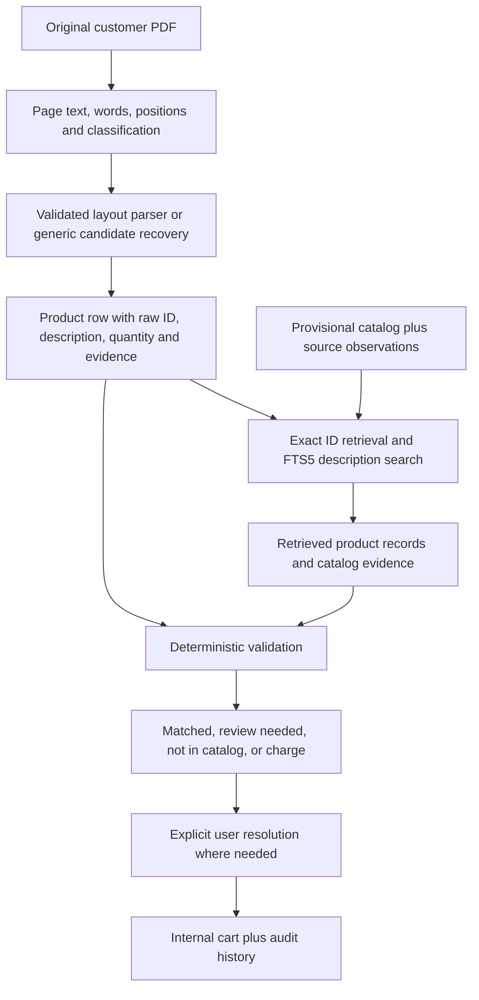

# Grounded purchase-order logic

The current scope is code logic: read customer PDFs/images, extract business fields and requested products, compare against catalog records, expose uncertainty, and stage verified choices in an internal cart. The vision engine is now the CLI default, with local Ollama or an optional configured OpenAI provider. This document records the earlier native engine. UI/UX belongs in another chat; the website catalog and importer/cart schema are not yet supplied.

See [Vision extraction and catalog comparison](vision-catalog-design.md) for the implemented extraction/comparison contracts, examples, cart eligibility rules, and evaluation requirements, and [Evaluating the vision reader](vision-evaluation.md) for independent gold labels and corpus measurements.

## Native engine architecture

The native engine implements retrieval and deterministic decision rules. The vision engine reads page images and uses a separate model task for semantic catalog comparison; both feed independent catalog, source, quantity and field validators. Local Ollama requests stay on the project loopback server. OpenAI requests occur only when that provider and an API key/model are configured. Retrieval makes relevant records available and supports evidence inspection.

Knowledge and document evidence are distinct. The catalog is allowed to contain only the 18 sample-derived product IDs under the user's current assumption. Uploaded PDFs are customer requests to interpret; they do not automatically add catalog entries, aliases or rules. Catalog names are descriptive sample labels, not verified official Werner names. Any future customer-SKU crosswalk must be company-specific and explicitly approved.

## Tool and algorithm choices

| Choice | Reason | Practical limit |
| --- | --- | --- |
| pdfplumber/pdfminer text and word coordinates | All eight inspected pages have text layers. Positioned extraction retains exact source characters and allows separation of table columns and delivery regions. | Text layers can omit image text or contain previous OCR errors. Geometry and fonts may be irregular. |
| pypdf as an independent reader | Product/order IDs can be cross-checked for extraction disagreement. | Two readers agreeing on an erroneous text layer does not establish visual truth. It is an extra signal, not a guarantee. |
| Validated sample layout adapters | Recover wrapped descriptions, explicit customer-versus-supplier columns and multipage supplier-number continuation. | These adapters contain tested geometry for seven formats. They are not a universal parser, and changed layouts must abstain or recover review candidates. |
| Generic header-based candidates | Quantity/description/identifier headings can recover candidate rows when company/layout is unfamiliar or moved. | Every generic-layout row needs confirmation. Company and shipping fields stay unresolved rather than being guessed. |
| SQLite product primary keys + local FTS5/BM25 search | Exact IDs are precise; lexical retrieval finds description candidates and carries provenance. Eighteen products do not justify an embedding service. | Lexical retrieval can miss synonyms. Semantic embeddings can be added as a candidate-retrieval strategy after evaluating a larger corpus, without changing acceptance rules. |
| Token-set reranking and numeric characteristic checks | Reorder suggestions and reject a different tread count when numeric characteristics are present. | The overlap threshold 0.45 is provisional; scores are not calibrated probabilities. Terms such as material/height require more structured catalog attributes later. |
| Decimal quantity handling | Preserve quantity strings and avoid binary floating-point rounding. | Ambiguous comma conventions, zero/negative/malformed quantities require review; no separator guessing or pack conversion. |
| PDFium source-region rendering | Provide later OCR/review with precise page evidence, memory budgets and on-demand rendering. | Rendering does not improve semantic matching by itself. Rotated/cropped pages need more fixtures. |

The choice of native text before OCR follows the [pypdf extraction documentation](https://pypdf.readthedocs.io/en/stable/user/extract-text.html). The available coordinate objects and extraction limitations are described in [pdfplumber's documentation](https://github.com/jsvine/pdfplumber). FTS query/ranking behavior is documented in [SQLite FTS5](https://sqlite.org/fts5.html). General RAG background is in [Microsoft's retrieval overview](https://learn.microsoft.com/en-us/azure/search/retrieval-augmented-generation-overview); this project does not use Azure.

## Evidence and decision rules

1. Preserve raw PDF bytes, SHA-256, original extracted text and word coordinates. Values returned by a parser are observations, not permission to change the source.
2. Separate customer item number, supplier number/MPN, description-embedded IDs, quantity and unit. Do not treat the PDF filename as the order number.
3. Retrieve exact catalog IDs first. Search description evidence for additional candidates; each hit includes sample filename, hash, source row, page and bounding boxes. Record a catalog fingerprint with the decision.
4. A known ID plus compatible description, valid quantity, validated layout and corroborated source ID can be staged as `matched`. A missing unit stays null; no default EACH is inserted. This is not authorization to export or place an order.
5. Conflicting IDs, a description mismatch, a pack unit, missing quantity, reader disagreement or generic layout produce `review_needed`. Missing catalog IDs produce `not_in_catalog`; never claim they do not exist in Werner's full catalog.
6. Suggestions are possible choices, not substituted values. A user must specify a catalog product number and explicitly confirm ambiguous, manual or edited cart rows. Unknown IDs cannot enter the cart. A changed catalog fingerprint also requires confirmation.
7. Keep country, postcode, phone and identifiers as strings. Country comes from the shipping region's explicit text; supplier country and currency never override it. Blank shipping remains missing. Raw postcode is preserved alongside a separately formatted postcode value.
8. A manual confirmation is an auditable correction for that order. It does not train a model or become a global `PI -> PO` rule. If readers disagree, preserve the observation and flag it; no character repair is applied.

## Coverage and expansion

The seven supplied files are both the source for the provisional catalog and the current regression corpus. Perfect agreement on these files is not an estimate of accuracy for new customers. The current sample product decisions are 19 matched rows, 4 review rows (three conflicting identifiers and one pack unit), plus one excluded shipping charge.

The target is broad customer-PDF coverage, with explicit uncertainty for every unsupported case. Native text, image-only scans, mixed pages, OCR text layers, rotated pages, different languages, unfamiliar tables, password-protected PDFs and malformed files need separate handling and evaluation. OCR is currently flagged, not performed. The prototype resource limits are 20 MB and 50 pages, not a promise to read arbitrary-sized files.

Next engineering work: larger human-labeled and held-out corpus; local OCR with region evidence and reader disagreement checks; more geometry fixtures and fallback coverage; structured product attributes and company-specific customer-SKU crosswalks; quantitative precision/recall/review-rate tracking; process-isolated parsing with time/memory budgets. Maximize correct coverage while preserving abstention for uncertain values.

## Module boundaries

- `engine.py`: page extraction, sample layouts, field evidence and source corroboration.
- `profiles.py`: explicitly tested sample geometry/anchors.
- `generic.py`: unknown-layout candidate recovery, always reviewed.
- `catalog.py`: provisional product database and deterministic comparison primitives.
- `retrieval.py`: interchangeable retrieval provider, currently exact lookup and FTS5/BM25.
- `grounding.py`: retrieved context and auditable matching decision.
- `service.py`: persisted review sessions, cart validation and confirmations; no HTTP server/UI.
- `rendering.py`: bounded source-region rendering/cache, independent of extraction decisions.
- `reader.py`: CLI entry point. Its JSON is internal evidence/state, not the deferred importer schema.
- `vision.py` and `model_provider.py`: page-level model extraction and validated provider contracts.
- `model_matching.py`: semantic comparison recommendations and catalog/source/quantity eligibility checks.
- `benchmark_vision.py`: inventory, duplicate groups and independent gold-label scoring without cart writes.
