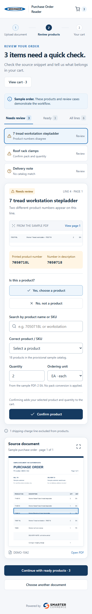
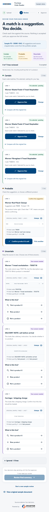

# T-005 mockup v2 evidence

Before: `origin/main` at `4bf061b06d12bb229a771705153a58f9b2d88a7b`. After: `chat/mockup-v2`. Both use the same synthetic DEMO-1042 purchase order, seven line images, sample catalog, and local brand assets.

The previous interface counted three matched rows as ready at startup. V2 begins with all seven lines pending, groups them into Certain, Probable, and Uncertain, keeps three explicit answers on uncertain lines, preserves ignored evidence, and requires a final approval after every line has a human decision.

| View | Before | After |
| --- | --- | --- |
| Phone · 390 × 844 viewport | [Before phone](screenshots/before-phone.png) | [After phone](screenshots/after-phone.png) |
| Desktop · 1440 × 1000 viewport | [Before desktop](screenshots/before-desktop.png) | [After desktop](screenshots/after-desktop.png) |

Phone review before:

Phone review after:

Additional interaction evidence:

- [Uncertain line, sample-catalog selection still pending](screenshots/after-uncertain-phone.png).
- [Sample approved after the separate final tap](screenshots/after-approval-phone.png). This exercises the new-product answer with a deliberately fictional test entry entered during QA; it is a session-local addition and is not a new source fixture.

The screenshots use full-page capture; viewport dimensions above are CSS pixels. All after images are regenerated by `node web/po-reader-mockup/tests/mockup-v2.cjs`. See [the verification notes](../../web/po-reader-mockup/QA.md) for scope and limits.
