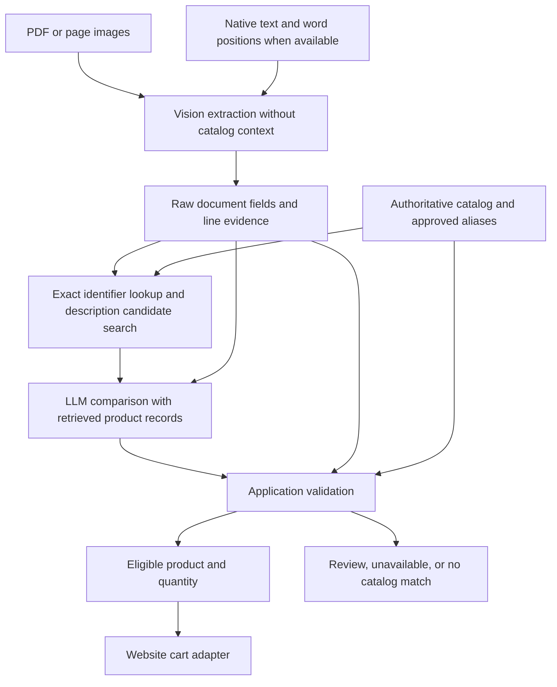

# Vision extraction and catalog comparison

The current working direction is [PROJECT_GOAL.md](../PROJECT_GOAL.md): separate pretrained 8B extraction, embedding/reranker candidates and selective gpt-oss adjudication, with training deferred. See [self-hosted infrastructure](self-hosted-infrastructure.md) and [first measured results](framework-first-results.md). The contracts below remain relevant; descriptions of the earlier single-model workflow are historical where the current goal supersedes them.

Prepared October 1, 2026. Implemented model workflow: read a customer PO, identify the product code printed on each line, confirm its relationship to a catalog product, and stage the verified product and quantity in a cart. Local Ollama and optional OpenAI providers implement the extraction and comparison contracts. Actual website cart integration awaits the website catalog and API schema. Independent development labels cover two PDFs / 14 rows; measurement is recorded by `benchmark_vision.py`.

## Design direction

Use a vision model as the primary document reader and an LLM to compare extracted descriptions and attributes with retrieved catalog records. Use application code to verify database membership, exact identifiers or approved aliases, quantities, units, and eligibility for cart staging.

The expected benefit is coverage of unfamiliar layouts, scans, handwriting, and differently written product names with fewer supplier-specific parsing rules. Higher exact-code accuracy must be measured on labeled PDFs. Vision can misread small text or a single character, and structured output can still contain incorrect values. Existing native PDF text and positions remain useful independent observations when available. OpenAI's PDF input processing already supplies both extracted text and page images to supported vision models: [file inputs](https://developers.openai.com/api/docs/guides/file-inputs). Relevant limitations: [images and vision](https://developers.openai.com/api/docs/guides/images-vision), [structured outputs](https://developers.openai.com/api/docs/guides/structured-outputs).



These are two distinct tasks and calls. The same model may perform both tasks. The first call observes the document without catalog suggestions; the second interprets the relationship to catalog records. Agreement between two calls to the same model is not independent proof of correctness.

## Extraction contract

Capture PO number, date, supplier, buyer, billing and shipping fields, every product line, quantities and units, amounts, currency, totals, notes, and additional labeled business fields. Preserve an additional-fields array for fields outside the fixed schema. Processing pages separately or in bounded groups requires explicit reconciliation of continuation rows, repeated headers, notes, and document totals.

Each observed field retains its raw string, page number, printed label if present, extraction status (`observed`, `uncertain`, or `missing`), and evidence reference. Missing fields stay null. Preserve all different identifiers with their source labels, such as customer item, vendor part number, and manufacturer model; do not merge them into one assumed ID. The document PO number remains a separate field.

For each product line preserve:

- A stable source line reference, page number, and row evidence.
- All printed identifiers as strings, including punctuation, suffixes, and leading zeros.
- The description as printed and separately extracted attributes such as material, size, model, capacity, or pack count.
- Quantity and unit as printed, with independently validated parsed values.
- Line amount and price if present, and whether the row represents a product, charge, or an uncertain row.
- Missing or ambiguous characters and any disagreement with native extraction.

Example below is invented to illustrate the contract, not a measured extraction from the supplied PDFs:

```json
{
  "line_ref": "page-1-row-3",
  "identifiers": [
    {"raw_value": "76-76", "printed_label": "Product ID", "role": "vendor_product_code", "status": "observed"}
  ],
  "description_raw": "Latex gloves, medium, box of 100",
  "quantity_raw": "10",
  "unit_raw": "BOX",
  "attributes": {"material": "latex", "size": "medium", "units_per_pack": "100"},
  "evidence": {"page": 1, "region_ref": "page-1-row-3", "transcription": "76-76 Latex gloves, medium, box of 100 10 BOX"}
}
```

Page and crop evidence must remain tied to the original document. A model-provided quote or bounding box is another observation, not proof. Validate page and coordinate ranges; use positioned native words when available to corroborate identifiers and locate source regions. If a critical code is unclear, reread a sufficiently detailed crop or request review. Retain both readings when they disagree. Catalog similarity alone cannot repair the source transcription.

## Catalog retrieval and LLM comparison

First look up the observed identifier in the proper catalog field or an approved alias scoped to the applicable supplier/customer. Separately search descriptions to retrieve other plausible candidates for review or detect conflicts. Supply the comparison call with the immutable extracted line and the actual retrieved records, including canonical IDs, names, attributes, identifiers and alias scope, product status, and supported units where available. A production catalog should be retrieved in bounded candidate sets rather than pasted into every request.

The comparison call returns a selected candidate ID or null, a description relationship (`compatible`, `conflict`, or `insufficient_information`), relevant attribute agreements and conflicts, missing information, and brief reasons tied to source and catalog fields. Candidate IDs can be constrained to the retrieved list plus null. The application independently checks membership even when the model output is constrained.

The model can recognize wording equivalence such as "latex gloves" and "natural latex examination gloves." Compare distinguishing attributes: latex versus nitrile, medium versus large, sterile versus nonsterile, or a box of 100 versus 50. A generic shared product name is insufficient evidence that two variants are the same.

Do not use an invented percentage confidence as the acceptance threshold. Model confidence and lexical overlap are not calibrated probabilities. Initial eligibility follows explicit evidence and validation rules; later thresholds require measured behavior on labeled data.

## Cart eligibility

A line becomes eligible for automatic staging only when all of these checks pass:

1. The chosen record exists in the authoritative catalog and is eligible for the website cart.
2. Its recognized product identifier matches the observed line identifier exactly after documented conservative normalization, or through an approved alias with the correct business scope.
3. The source identifier is unambiguous and has no unresolved conflicting readings or identifier roles.
4. The description is compatible and has no conflicting distinguishing attributes; insufficient comparison evidence initially requires review.
5. Quantity is positive, the ordering unit is supported, and any unit conversion comes from catalog/business rules.
6. The source row is a product line and belongs to the correct document; unresolved continuation or repeated-page issues require review.
7. The product is revalidated against the current catalog before the cart operation.

The cart adapter receives the website's canonical product/variant key and validated ordering quantity/unit. The LLM output provides a recommendation; the application creates the final cart command. Track document hash, source line, raw observations, extraction and comparison model versions, catalog version, decision reasons, and any human correction. Use a stable operation key for retrying the same cart action so a network retry cannot duplicate a line.

Illustrative decisions:

| PDF line | Catalog evidence | Decision |
| --- | --- | --- |
| `76-76`, latex gloves, medium, box of 100 | Same ID; natural latex examination gloves, M, 100 per box | Description compatible; eligible after source, quantity, unit, and catalog checks |
| `76-76`, latex gloves | Same ID; nitrile gloves | Material conflict; review |
| `76-76`, latex gloves | Similar description under `76-78`, no approved alias | Candidate suggestion; review the identifier |
| Unreadable ID, latex gloves | Several sizes or packs with similar names | Request a clearer source reading or review |

## Fit with the current prototype

The local `products` table has `id`, `name`, `variants`, and `provenance`, with 18 sample-derived product IDs. It does not supply the website's authoritative product/variant key, structured variant attributes, availability, ordering rules, or approved identifier aliases. Production mapping awaits the website catalog schema or a catalog export; additional products cannot become authoritative merely because they appear in an uploaded PO.

The implementation reuses document rendering, preserved evidence, exact ID retrieval, review state, catalog fingerprints, and cart validation. Interchangeable OpenAI/Ollama providers implement the same extraction and comparison contracts. Model retrieval accepts the broader observed identifier forms. Model comparison drives description interpretation in the vision engine, while catalog/source/quantity checks determine cart eligibility. The native engine retains its earlier word-overlap interpretation for comparison.

A text-only local LLM needs OCR observations or native PDF text. The `qwen3-vl:4b-instruct` vision model directly reads page images through the project-local Ollama server on port 11435. The explicit instruction tag is required for this workflow: the default thinking checkpoint consumed the full output budget before returning JSON on the initial PDF benchmark. Hosted OpenAI use requires an API key and a chosen vision model. The real website catalog and cart schema are still needed for website integration.

Automatic staging also requires the PO number to be supported by a positioned native header, independent native text, and returned quoted evidence. Rows on pages identified as invoice, other, or uncertain remain review rows. Image-only observations can still recover fields and suggest catalog products; their critical readings require confirmation until an independent visual/OCR verification path is evaluated.

## Evidence required before automation

Label the supplied corpus with printed PO numbers and all product lines, identifier roles, quantities/units, and page evidence. Group duplicate pages and related PO documents in the same evaluation split. Keep supplier/layout groups for held-out assessment; do not infer generalized accuracy from catalog seed documents.

Compare vision extraction and model reconciliation with the existing parser on the same labels. Measure line recall, exact identifier accuracy by role, PO-number accuracy, quantity/unit accuracy, incorrect automatic cart eligibility, review rate, latency, and cost. Manually inspect omitted rows and source-reading conflicts. Both model stages must be evaluated separately so a catalog match cannot conceal an extraction error. Run the initial prototype as shadow decisions before connecting website cart writes.
